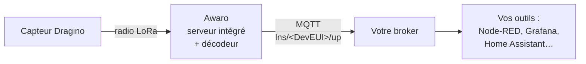
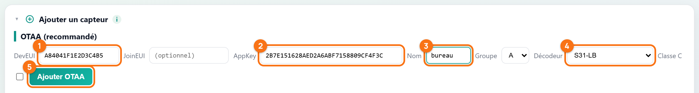
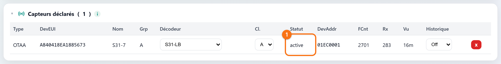
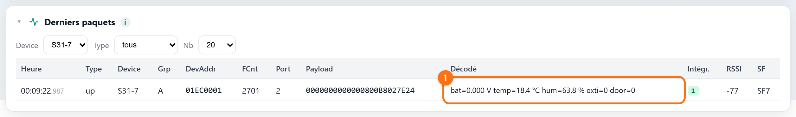
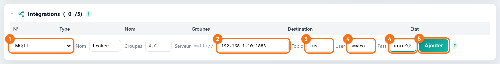

# Recevoir les mesures d'un capteur Dragino sur votre broker MQTT

Vous avez une box Awaro, un capteur Dragino et un broker MQTT (Mosquitto,
EMQX, HiveMQ, celui de Home Assistant…). Vous voulez voir arriver vos
températures sur ce broker, en clair, sans passer par TTN ni ChirpStack.

Bonne nouvelle : la box sait tout faire seule. Elle accueille le capteur,
déchiffre ses trames, les **décode** et publie des mesures lisibles sur votre
broker. Prêt ? C'est parti !

*Captures réalisées sur une Awaro LT en firmware 3.6.5 et 3.6.6, avec un
Dragino S31-LB (température et humidité).*

## Petit rappel : qui fait quoi ?



Dans une installation LoRaWAN classique, la passerelle ne fait que relayer :
un serveur sur Internet (TTN, ChirpStack) gère les capteurs et décode les
trames. Avec le **serveur intégré**, tout ce travail se fait dans la box. Vos
données ne quittent pas votre réseau, sauf si vous le décidez.

## Ce qu'il vous faut

- une box **Awaro** connectée à votre réseau, et son adresse IP ;
- un capteur **Dragino** en OTAA, avec ses clés : le **DevEUI** et l'**AppKey**
  figurent sur l'étiquette livrée avec le capteur ;
- un capteur réglé sur **la même bande de fréquences que la box** (EU868 en
  Europe) ;
- l'adresse de votre **broker MQTT** (hôte et port), et son identifiant et son
  mot de passe s'il en demande ;
- un client pour regarder passer les messages : `mosquitto_sub` en ligne de
  commande, ou [MQTT Explorer](https://mqtt-explorer.com/) si vous préférez la
  souris.

## Étape 1 : activer le serveur intégré

Ouvrez la page de configuration de la box (`http://<adresse-de-la-box>/`).
Dans la carte **Serveur réseau**, cliquez sur **Serveur LoRaWAN intégré**
(repère 1). Le réglage est enregistré aussitôt.


*Le serveur intégré est actif et le serveur externe éteint : la ligne grise
le confirme, aucune donnée ne part vers un serveur externe.*

Les deux boutons donnent trois fonctionnements possibles :

| Boutons allumés | Ce que fait la box | Pour qui |
|---|---|---|
| **Serveur intégré** seul | Elle gère et décode tous les capteurs ; rien ne part vers un serveur externe. | Ce tuto. Idéal en 4G : économie de données. |
| **Serveur externe** seul | Elle relaie toutes les trames vers TTN, ChirpStack… sans rien décoder. | Vous avez déjà votre serveur LoRaWAN. |
| **Les deux** | Les capteurs déclarés dans la box sont traités par la box ; les autres partent vers le serveur externe. | Migration en douceur, ou parc partagé entre deux serveurs. |

> [!WARNING]
> **Attention à la concurrence !** Un capteur ne se déclare qu'à **un seul**
> endroit : dans la box **ou** sur le serveur externe. Déclaré des deux côtés,
> il reçoit des réponses des deux serveurs, avec des clés de session
> différentes : l'un des deux ne comprend plus ses trames.

Cliquez ensuite sur **Gérer — capteurs & intégrations →** : vous arrivez sur
la page du serveur LoRaWAN (`/lns`). Tout le reste se passe ici.

## Étape 2 : déclarer le capteur

Dans la carte **Ajouter un capteur**, section **OTAA (recommandé)** :



*Le formulaire rempli avec des clés d'exemple : seuls le DevEUI, l'AppKey et
le décodeur sont indispensables.*

1. **DevEUI** : les 16 caractères de l'étiquette (un DevEUI Dragino commence
   par `A84041`).
2. **AppKey** : les 32 caractères de l'étiquette.
3. **Nom** : le nom qui apparaîtra dans vos messages, par exemple `bureau`.
4. **Décodeur** : choisissez le modèle de votre capteur dans la liste
   (ici `S31-LB`). Les décodeurs Dragino courants sont intégrés à la box.
5. **Ajouter OTAA**.

Le **JoinEUI** (ou AppEUI) est facultatif : vous pouvez le laisser vide.
Laissez **Classe C** décochée, sauf pour un actionneur alimenté sur secteur.

> [!WARNING]
> **Le piège : le capteur déclaré deux fois.** Si ce capteur était déjà
> enregistré sur TTN ou ChirpStack, supprimez-le là-bas avant de le réveiller
> (voir l'encadré de l'étape 1).

## Étape 3 : réveiller le capteur

Les Dragino de la série LB sont livrés endormis. Appuyez **plus de 3 secondes**
sur le bouton **ACT** : la LED verte clignote vite 5 fois, puis le capteur
tente de rejoindre le réseau. Quand il a réussi, la LED verte reste allumée
5 secondes ([documentation Dragino du S31-LB](https://wiki.dragino.com/docs/LoRaWAN-End-Node/temperature-humidity-sensors/s31-lb/)).

Côté box, la carte **Capteurs déclarés** le confirme :



*Statut `active` : le capteur a rejoint la box et une adresse (DevAddr) lui a
été attribuée. La colonne Vu indique sa dernière trame.*

Et la carte **Derniers paquets**, filtrée sur votre capteur (menu **Device**),
montre déjà les mesures décodées :



*La trame brute (colonne Payload) devient des mesures lisibles : c'est le
décodeur intégré qui a fait le travail.*

## Étape 4 : brancher votre broker

Dans la carte **Intégrations**, remplissez la ligne du bas :



*Une intégration MQTT prête à être ajoutée ; l'adresse et les identifiants
sont des exemples.*

1. **Type** : `MQTT`. Donnez-lui un **Nom** pour la reconnaître.
2. **Serveur** : `hôte:port` de votre broker, par exemple `192.168.1.10:1883`.
   Pour un broker sur Internet, préférez une connexion chiffrée :
   `mqtts://hôte:8883`.
3. **Topic** : le préfixe des messages ; laissez `lns` si vous n'avez pas
   d'avis.
4. **User** et **Pass** : ceux du broker, s'il en demande.
5. **Ajouter**.

Le champ **Groupes** sert à n'envoyer qu'une partie de vos capteurs : laissez-le
vide pour les envoyer tous.

Attendez une vingtaine de secondes, puis cliquez sur **test** dans la ligne de
l'intégration : la box publie un message d'essai et la colonne **État** passe
au vert.

> [!WARNING]
> **Le piège : tester trop tôt.** La connexion au broker met une vingtaine de
> secondes à s'établir. Un test lancé juste après l'ajout répond « MQTT non
> connecté (broker ?) » alors que tout est correct. Patientez, puis
> recommencez.

## Étape 5 : vérifier sur le broker

La box publie chaque trame sur le topic `lns/<DevEUI>/up`. Abonnez-vous à tout
ce qui commence par `lns/` :

```bash
mosquitto_sub -h 192.168.1.10 -p 1883 -u awaro -P 'votre-mot-de-passe' -t 'lns/#' -v
```

À la prochaine trame du capteur (ou tout de suite avec un appui court, de 1 à
3 secondes, sur le bouton ACT), un message de ce genre arrive :

```json
{"type":"up","ts":1786289142,"deveui":"A840418EA1885673","name":"S31-7",
 "group":19,"decoder":"S31-LB","addr":"01000001","fport":2,"fcnt":4,
 "len":12,"data":"000000000000080116022A24","rssi":-47,"snr":9.2,"sf":7,
 "decoded":{"bat":0.000,"temp":27.8,"hum":55.4}}
```

| Champ | Ce qu'il contient |
|---|---|
| `decoded` | Les mesures en clair, prêtes à l'emploi. Présent si un décodeur est choisi et reconnaît la trame. |
| `ts` | L'heure de réception radio, en secondes Unix. |
| `deveui`, `name` | Qui parle : identifiant et nom du capteur. |
| `data` | La trame brute déchiffrée, en hexadécimal, si vous voulez la décoder vous-même. |
| `rssi`, `snr`, `sf` | La qualité de la liaison radio. |
| `replay` | Vaut `true` sur une trame renvoyée après une coupure réseau ; absent sinon. |

> [!IMPORTANT]
> **Le bon réglage : horodatez avec `ts`.** Si le réseau tombe, la box garde
> les trames et les renvoie au retour de la connexion. Elles arrivent alors
> longtemps après leur réception radio : seule `ts` donne la bonne heure.

## En résumé

- Le **serveur intégré** remplace TTN ou ChirpStack : il s'active d'un clic
  dans la page de configuration.
- Un capteur Dragino se déclare avec son **DevEUI**, son **AppKey** et son
  **décodeur**, puis se réveille par un appui long sur **ACT**.
- Une intégration **MQTT** publie chaque mesure décodée sur
  `lns/<DevEUI>/up`.
- Horodatez vos données avec le champ **`ts`**, pas avec l'heure d'arrivée.

Et vous, que faites-vous de vos mesures une fois sur le broker ? Racontez-le
nous, ou signalez un souci, dans les
[issues du dépôt](https://github.com/Di-Ny/awaro/issues).
