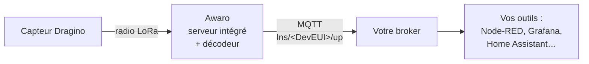

# Recevoir les mesures d'un capteur Dragino sur votre broker MQTT

Vous avez une box Awaro, un capteur Dragino et un broker MQTT (Mosquitto,
EMQX, HiveMQ, celui de Home Assistant…). Vous voulez voir arriver vos
températures sur ce broker, en clair, sans passer par TTN ni ChirpStack.

Bonne nouvelle : la box sait tout faire seule. Elle accueille le capteur,
déchiffre ses trames, les **décode** et publie des mesures lisibles sur votre
broker. Prêt ? C'est parti !

*Captures réalisées sur une Awaro LT en firmware 3.6.5 et 3.6.6, avec un
Dragino S31-LB (température et humidité). Les pastilles orange numérotées
renvoient aux tableaux sous chaque capture.*

## Petit rappel : qui fait quoi ?



Dans une installation LoRaWAN classique, la passerelle ne fait que relayer :
un serveur sur Internet (TTN, ChirpStack) gère les capteurs et décode les
trames. Avec le **serveur intégré**, tout ce travail se fait dans la box. Vos
données ne quittent pas votre réseau, sauf si vous le décidez.

## Ce qu'il vous faut

- une box **Awaro** connectée à votre réseau, et son adresse IP ;
- un capteur **Dragino** en OTAA, avec ses clés : le **DevEUI** et l'**AppKey**
  figurent sur l'étiquette livrée avec le capteur ;
- un capteur réglé sur **la même bande de fréquences que la box** (EU868 en
  Europe) ;
- l'adresse de votre **broker MQTT** (hôte et port), et son identifiant et son
  mot de passe s'il en demande ;
- un client pour regarder passer les messages : `mosquitto_sub` en ligne de
  commande, ou [MQTT Explorer](https://mqtt-explorer.com/) si vous préférez la
  souris.

## Étape 1 : activer le serveur intégré

Ouvrez la page de configuration de la box (`http://<adresse-de-la-box>/`) et
descendez jusqu'à la carte **Serveur réseau**.


*Le serveur intégré est actif et le serveur externe éteint : la ligne grise
le confirme, aucune donnée ne part vers un serveur externe.*

| Repère | Élément | À quoi il sert | Dans ce tuto |
|---|---|---|---|
| — | Ligne grise sous le titre | Résume le réglage en cours. | Lecture seule. |
| 1 | Bouton **Serveur LoRaWAN intégré** | Allume le serveur LoRaWAN de la box : elle gère les capteurs déclarés et décode leurs trames. | **Allumé** (cadre vert). |
| — | Lien **Gérer — capteurs & intégrations →** | Ouvre la page du serveur intégré (`/lns`). | À cliquer à la fin de l'étape. |
| — | Bouton **Serveur externe (TTN, ChirpStack…)** | Relaie les trames radio vers un serveur LoRaWAN externe. Allumé, il fait apparaître les champs **Serveur NS** et **Port NS** de ce serveur. | **Éteint**. |
| — | **ID Passerelle** | Identifiant de la box (Gateway EUI), à recopier quand on la déclare sur un serveur externe. | Lecture seule, inutile ici. |

Cliquez sur **Serveur LoRaWAN intégré** pour l'allumer, et sur **Serveur
externe** pour l'éteindre s'il était allumé. Chaque clic est enregistré
aussitôt, sans redémarrage.

Les deux boutons donnent trois fonctionnements possibles :

| Boutons allumés | Ce que fait la box | Pour qui |
|---|---|---|
| **Serveur intégré** seul | Elle gère et décode tous les capteurs ; rien ne part vers un serveur externe. | Ce tuto. Idéal en 4G : économie de données. |
| **Serveur externe** seul | Elle relaie toutes les trames vers TTN, ChirpStack… sans rien décoder. | Vous avez déjà votre serveur LoRaWAN. |
| **Les deux** | Les capteurs déclarés dans la box sont traités par la box ; les autres partent vers le serveur externe. | Migration en douceur, ou parc partagé entre deux serveurs. |

> [!WARNING]
> **Attention à la concurrence !** Un capteur ne se déclare qu'à **un seul**
> endroit : dans la box **ou** sur le serveur externe. Déclaré des deux côtés,
> il reçoit des réponses des deux serveurs, avec des clés de session
> différentes : l'un des deux ne comprend plus ses trames.

Cliquez enfin sur **Gérer — capteurs & intégrations →** : vous arrivez sur la
page du serveur LoRaWAN (`/lns`). Tout le reste se passe ici.

## Étape 2 : déclarer le capteur

Ouvrez la carte **Ajouter un capteur**, section **OTAA (recommandé)**.


*Le formulaire rempli avec des clés d'exemple.*

| Repère | Champ | Ce que vous saisissez | Obligatoire ? |
|---|---|---|---|
| 1 | **DevEUI** | L'identifiant du capteur : 16 caractères hexadécimaux, sur l'étiquette. Un DevEUI Dragino commence par `A84041`. Les espaces et séparateurs sont nettoyés automatiquement. | Oui |
| — | **JoinEUI** | Aussi appelé AppEUI. Le capteur l'annonce lui-même au moment du join, et c'est l'AppKey qui l'authentifie. **Laissez vide.** | Non |
| 2 | **AppKey** | La clé secrète du capteur : 32 caractères hexadécimaux, sur l'étiquette. | Oui |
| 3 | **Nom** | Un nom libre, 23 caractères au plus, par exemple `bureau`. Il apparaît dans les tableaux et dans le champ `name` des messages. | Conseillé |
| — | **Groupe** | Une lettre de A à Z, `A` par défaut. C'est une étiquette : à l'étape 4, chaque intégration peut choisir les groupes qu'elle reçoit. **Laissez `A`.** | Non |
| 4 | **Décodeur** | Le modèle de votre capteur, ici `S31-LB`. Les décodeurs Dragino courants sont intégrés à la box. Sans décodeur, vous ne recevez que la trame brute, sans les mesures en clair. | Conseillé |
| — | **Classe C** | À cocher seulement pour un actionneur alimenté sur secteur, qui écoute en permanence (électrovanne, relais). Un capteur sur pile est en classe A : **laissez décoché.** | Non |
| 5 | **Ajouter OTAA** | Enregistre le capteur. | — |

La section **ABP**, juste en dessous, sert aux rares capteurs qui ne savent
pas faire de join : leur session se fixe à la main. Les Dragino utilisent
l'OTAA : ignorez-la.

> [!WARNING]
> **Le piège : le capteur déclaré deux fois.** Si ce capteur était déjà
> enregistré sur TTN ou ChirpStack, supprimez-le là-bas avant de le réveiller
> (voir l'encadré de l'étape 1).

## Étape 3 : réveiller le capteur et vérifier qu'il parle

Les Dragino de la série LB sont livrés endormis. Appuyez **plus de 3 secondes**
sur le bouton **ACT** : la LED verte clignote vite 5 fois, puis le capteur
tente de rejoindre le réseau. Quand il a réussi, la LED verte reste allumée
5 secondes ([documentation Dragino du S31-LB](https://wiki.dragino.com/docs/LoRaWAN-End-Node/temperature-humidity-sensors/s31-lb/)).

### La carte Capteurs déclarés


*Statut `active` (repère 1) : le capteur a rejoint la box et elle a déjà reçu
au moins une de ses trames.*

| Colonne | Ce qu'elle indique |
|---|---|
| **Type** | `OTAA` ou `ABP`. |
| **DevEUI** | L'identifiant du capteur. Un clic dessus reprend le capteur dans le formulaire de l'étape 2 pour le modifier. |
| **Nom**, **Grp** | Le nom et le groupe saisis à l'étape 2. |
| **Décodeur** | Le décodeur affecté ; il se change directement ici. |
| **Cl.** | La classe, A ou C ; elle se change aussi ici. |
| **Statut** (repère 1) | `never` : déclaré, jamais vu. `joined` : join réussi, aucune mesure reçue encore. `active` : au moins une trame reçue. |
| **DevAddr** | L'adresse courte attribuée au capteur lors du join. |
| **FCnt** | Le compteur de trames du capteur. |
| **Rx** | Le nombre de messages reçus par la box. |
| **Vu** | Depuis combien de temps la dernière trame est arrivée. |
| **Historique** | `Off` par défaut. Sur `100` ou `1000`, la box garde les derniers paquets du capteur en mémoire (téléchargeables en CSV par le bouton ⇩, vidés au redémarrage). Il sert aussi au rattrapage après une coupure réseau (voir l'étape 5). |
| **x** | Supprime le capteur. |

> [!IMPORTANT]
> **Le bon réglage : passez l'Historique à `100`.** Sans historique, une trame
> qui arrive pendant une coupure réseau est perdue pour votre broker. Avec,
> la box la renvoie dès le retour de la connexion. 100 lignes occupent 9 Ko
> de mémoire.

### La carte Derniers paquets

Choisissez votre capteur dans le menu **Device** : ses trames s'affichent,
déjà décodées.


*La trame brute (colonne Payload) devient des mesures lisibles (repère 1) :
c'est le décodeur intégré qui a fait le travail.*

| Élément | Ce qu'il indique |
|---|---|
| Filtre **Device** | N'affiche que les trames d'un capteur. |
| Filtre **Type** | `tous`, `join`, `uplink`, `downlink`, `décodé` ou `non décodé`. |
| Filtre **Nb** | Le nombre de lignes : 20 par défaut, jusqu'à 200 sur une box avec PSRAM. |
| **Heure** | L'heure de réception. |
| **Type** | `up` : trame d'un capteur déclaré, traitée par la box. `join`, `down` : procédures de connexion et commandes envoyées. `relayé` ou `ignoré` : capteur non déclaré, relayé vers le serveur externe ou ignoré selon le réglage de l'étape 1. |
| **Device**, **Grp**, **DevAddr**, **FCnt** | Le capteur émetteur, son groupe, son adresse et le numéro de la trame. |
| **Port** | Le port applicatif (FPort). Les Dragino envoient leurs mesures sur le port 2. |
| **Payload** | La trame déchiffrée, brute, en hexadécimal. |
| **Décodé** (repère 1) | Les valeurs lues par le décodeur. |
| **Intégr.** | Un badge par intégration : vert = livré, rouge = échec. Vide tant qu'aucune intégration n'existe. |
| **RSSI** | La puissance reçue, en dBm : plus proche de 0, meilleur signal. |
| **SF** | Le facteur d'étalement : SF7 est rapide, SF12 lent mais porte plus loin. |

## Étape 4 : brancher votre broker

Ouvrez la carte **Intégrations**. Le formulaire d'ajout est la ligne du bas.


*Une intégration MQTT prête à être ajoutée ; l'adresse et les identifiants
sont des exemples.*

| Repère | Champ | Ce que vous saisissez | Obligatoire ? |
|---|---|---|---|
| 1 | **Type** | `MQTT`. Les autres choix (HTTP, FurgoSuperviseur, ThingsBoard, Auto Discovery MQTT pour Home Assistant et Domoticz) feront l'objet d'autres tutos. | Oui |
| — | **Nom** | Un nom libre pour reconnaître l'intégration, par exemple `broker`. | Conseillé |
| — | **Groupes** | Les groupes de capteurs à envoyer, en lettres séparées par des virgules (`A,C`). Vide ou `tous` : tous les capteurs. **Laissez vide.** | Non |
| 2 | **Serveur** | `hôte:port` du broker, par exemple `192.168.1.10:1883`. Le préfixe `mqtt://` est ajouté tout seul ; tapez `mqtts://hôte:8883` (ou `wss://`) pour un broker chiffré, conseillé sur Internet. | Oui |
| 3 | **Topic** | Le préfixe des messages. Avec `lns` (la valeur par défaut), chaque trame part sur `lns/<DevEUI>/up`. | Non |
| 4 | **User**, **Pass** | Les identifiants du broker, s'il en exige. Lors d'une modification, un champ laissé vide garde l'ancienne valeur. | Selon le broker |
| 5 | **Ajouter** | Enregistre l'intégration. | — |
| — | **?** | Affiche l'aide du type choisi. | — |

Une fois ajoutée, l'intégration apparaît en ligne dans le tableau :

| Colonne | Ce qu'elle indique |
|---|---|
| **N°** | Son emplacement : 5 intégrations au plus par box. |
| **Type**, **Nom**, **Groupes** | Ce que vous avez saisi. |
| **Destination** | L'adresse du broker, suivie du topic entre crochets. |
| **État** | Le résultat de la dernière livraison : coche verte si tout va bien. |
| **modifier**, **test**, **x** | Reprendre l'intégration dans le formulaire, envoyer un message d'essai, la supprimer. |

Attendez une vingtaine de secondes, puis cliquez sur **test** : la box publie
un message d'essai et la colonne **État** passe au vert.

> [!WARNING]
> **Le piège : tester trop tôt.** La connexion au broker met une vingtaine de
> secondes à s'établir. Un test lancé juste après l'ajout répond « MQTT non
> connecté (broker ?) » alors que tout est correct. Patientez, puis
> recommencez.

> [!NOTE]
> Sur les anciens modèles sans PSRAM, la box ne tient qu'**une** connexion MQTT
> à la fois, et une connexion chiffrée (`mqtts://`) lui demande une trentaine
> de Ko de mémoire pendant son établissement. Sur ces modèles, préférez un
> broker en clair sur votre réseau local.

## Étape 5 : vérifier sur le broker

La box publie chaque trame sur le topic `lns/<DevEUI>/up`. Abonnez-vous à tout
ce qui commence par `lns/` :

```bash
mosquitto_sub -h 192.168.1.10 -p 1883 -u awaro -P 'votre-mot-de-passe' -t 'lns/#' -v
```

À la prochaine trame du capteur (ou tout de suite avec un appui court, de 1 à
3 secondes, sur le bouton ACT), un message de ce genre arrive :

```json
{"type":"up","ts":1786289142,"deveui":"A840418EA1885673","name":"S31-7",
 "group":19,"decoder":"S31-LB","addr":"01000001","fport":2,"fcnt":4,
 "len":12,"data":"000000000000080116022A24","rssi":-47,"snr":9.2,"sf":7,
 "decoded":{"bat":0.000,"temp":27.8,"hum":55.4}}
```

| Champ | Ce qu'il contient |
|---|---|
| `type` | `up` : une trame montante, du capteur vers la box. |
| `ts` | L'heure de réception radio, en secondes Unix. |
| `deveui`, `name` | L'identifiant et le nom du capteur. |
| `group` | Le groupe du capteur en chiffre : 1 = A, 2 = B… 26 = Z. |
| `decoder` | Le décodeur utilisé. |
| `addr` | L'adresse courte du capteur (DevAddr). |
| `fport`, `fcnt` | Le port applicatif et le numéro de la trame. |
| `len`, `data` | La longueur en octets et la trame brute déchiffrée, en hexadécimal, si vous voulez la décoder vous-même. |
| `rssi`, `snr`, `sf` | La qualité de la liaison radio. |
| `decoded` | Les mesures en clair, prêtes à l'emploi. Présent si le capteur a un décodeur et que la trame est reconnue. |
| `replay` | Vaut `true` sur une trame renvoyée après une coupure réseau ; absent sinon. |

> [!IMPORTANT]
> **Le bon réglage : horodatez avec `ts`.** Si le réseau tombe, la box garde
> les trames des capteurs dont l'**Historique** est activé (étape 3) et les
> renvoie au retour de la connexion. Elles arrivent alors longtemps après leur
> réception radio : seul `ts` donne la bonne heure.

## En résumé

- Le **serveur intégré** remplace TTN ou ChirpStack : il s'active d'un clic
  dans la page de configuration. Un capteur se déclare à un seul endroit.
- Un capteur Dragino se déclare avec son **DevEUI**, son **AppKey** et son
  **décodeur**, puis se réveille par un appui long sur **ACT**.
- Passez son **Historique** à `100` pour ne rien perdre en cas de coupure.
- Une intégration **MQTT** publie chaque mesure décodée sur
  `lns/<DevEUI>/up`.
- Horodatez vos données avec le champ **`ts`**, pas avec l'heure d'arrivée.

Et vous, que faites-vous de vos mesures une fois sur le broker ? Racontez-le
nous, ou signalez un souci, dans les
[issues du dépôt](https://github.com/Di-Ny/awaro/issues).
