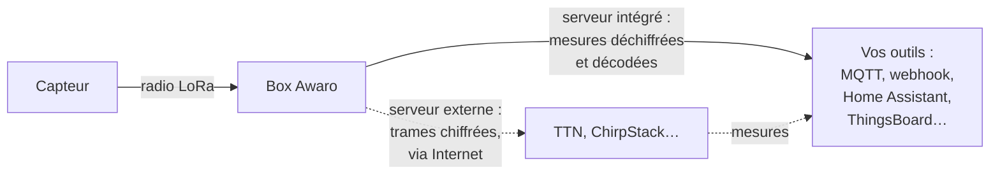
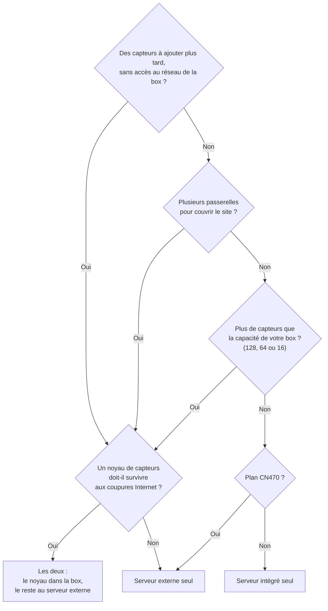

# Serveur LoRaWAN intégré ou serveur externe (TTN, ChirpStack) : lequel choisir ?

Votre box Awaro sait faire deux métiers. Elle peut **gérer vos capteurs
elle-même**, grâce à son serveur LoRaWAN intégré, ou **relayer leurs trames**
vers un serveur sur Internet comme TTN (The Things Network) ou ChirpStack.
Elle sait même faire les deux à la fois.

Alors, lequel choisir ? Spoiler : la radio est exactement la même dans les
deux cas. Ce qui change, c'est **qui détient les clés de vos capteurs**. Et
cette question en entraîne trois autres : d'où déclarez-vous un capteur,
qu'est-ce qui sort sur Internet, et que se passe-t-il quand Internet tombe ?

On mène l'enquête avec quatre installations types. Prêt ? C'est parti !

*Description valable pour le firmware 3.6.6. Les volumes de données ont été
mesurés sur notre banc d'essai, puis arrondis.*

## Petit rappel : qui fait quoi en LoRaWAN ?

Un réseau LoRaWAN, c'est trois rôles :

| Rôle | Ce qu'il fait | Chez vous |
|---|---|---|
| **Capteur** | Mesure, chiffre sa trame et l'envoie par radio. | Dragino, Milesight, Elsys… |
| **Passerelle** | Écoute la radio et transmet les trames, sans pouvoir les lire. | La box Awaro. |
| **Serveur de réseau** | Accueille le capteur (le *join*), détient ses clés, déchiffre ses trames, lui répond, puis livre les mesures à vos outils. | TTN, ChirpStack… ou la box Awaro elle-même. |

Avec le **serveur intégré**, la box joue les deux derniers rôles : rien ne
quitte votre réseau si vous ne le décidez pas. Avec un **serveur externe**,
elle n'est qu'une passerelle : c'est TTN ou ChirpStack qui détient les clés,
décode et redistribue. Un maillon de plus, hors de chez vous.

Ça vous parle ? Voyons maintenant comment la box passe de l'un à l'autre.

## Les trois fonctionnements

Tout se règle dans la carte **Serveur réseau** de la page de configuration,
avec deux boutons : **Serveur LoRaWAN intégré** et **Serveur externe (TTN,
ChirpStack…)**. Chaque clic est enregistré aussitôt, sans redémarrage. Seule
interdiction : tout éteindre. La page vous répond alors « Activez au moins
un des deux serveurs. »

| Boutons allumés | Ce que fait la box | Pour qui |
|---|---|---|
| **Serveur intégré** seul | Elle gère et décode tous les capteurs déclarés ; les autres sont ignorés, et rien ne part vers un serveur externe. | Vous voulez vos mesures sans serveur à gérer. Idéal en 4G : aucun trafic vers un serveur externe. |
| **Serveur externe** seul | Elle relaie toutes les trames vers TTN, ChirpStack… sans rien décoder. Les capteurs déclarés dans la box ne sont pas traités. | Vous avez déjà votre serveur LoRaWAN. |
| **Les deux** | Les capteurs déclarés dans la box sont traités par la box ; les autres partent vers le serveur externe. | Migration en douceur, ou parc partagé entre deux serveurs. |

En mode **les deux**, le tri se fait capteur par capteur : déclarer un
capteur dans la page `/lns` le fait passer au traitement local, le supprimer
le renvoie au serveur externe.

> [!WARNING]
> **Attention à la concurrence !** Un capteur ne se déclare qu'à **un seul**
> endroit : dans la box **ou** sur le serveur externe. Déclaré des deux côtés,
> il reçoit des réponses des deux serveurs, avec des clés de session
> différentes : l'un des deux ne comprend plus ses trames. Même règle entre
> deux box Awaro qui ont chacune leur serveur intégré : un capteur, une box.

## Ce qui sort de la box

| | Serveur intégré seul | Serveur externe seul | Les deux |
|---|---|---|---|
| **Vers le serveur externe** | **Rien** : ni trame, ni signal de vie, ni statistiques. | Toutes les trames radio, encore chiffrées, plus un signal de vie toutes les 25 s et un rapport de statistiques (toutes les 5 min par défaut). | Les trames des capteurs **non déclarés**, plus le signal de vie et les statistiques. |
| **Vers vos intégrations** (MQTT, webhook, ThingsBoard, Home Assistant) | Les mesures **décodées** des capteurs déclarés, accompagnées de la trame brute. | Aucune mesure : c'est le serveur externe qui les distribue. | Les mesures décodées des capteurs déclarés. |
| **Où vivent les clés des capteurs** | Dans la box, chez vous. | Chez l'hébergeur du serveur. | Dans la box pour les capteurs déclarés, chez l'hébergeur pour les autres. |
| **Dans tous les cas** | La box demande l'heure (NTP), vérifie ses mises à jour toutes les 6 h, et parle à la supervision si vous l'avez activée. | Idem. | Idem. |

> [!NOTE]
> Le signal de vie ne transporte **aucune** mesure. Il garde ouverte, dans
> votre box Internet ou votre routeur 4G, la porte par laquelle le serveur
> externe renvoie ses réponses aux capteurs. C'est lui qui consomme, même
> quand aucun capteur ne parle.

## Combien de données sur votre forfait ?

Sur une Awaro branchée à votre box Internet, ces volumes ne pèsent guère. En
4G, chaque mégaoctet compte. Voici ce que nous avons mesuré sur notre banc,
en trois tableaux.

### Le coût fixe, avant le moindre capteur

| Fonctionnement | Ce qui part | Par mois |
|---|---|---|
| Serveur externe seul, ou les deux | Signal de vie toutes les 25 s et statistiques toutes les 5 min (réglages par défaut actuels). | ~9 Mo |
| *Pour comparaison :* même chose aux cadences d'origine | Signal de vie toutes les 10 s, statistiques toutes les 30 s. | ~35 Mo |
| Serveur intégré + supervision (FurgoSuperviseur ou votre ThingsBoard) | Connexion MQTT entretenue, état de la box toutes les 5 min, lecture de sa configuration. | ~14 Mo, quel que soit le nombre de capteurs |
| Serveur intégré seul, intégrations sur votre réseau local | L'heure et la vérification des mises à jour. | ~0,3 Mo |

### Le coût par capteur

Mesuré avec un Dragino S31-LB, dont la trame porte 12 octets de mesures.

| Chemin d'une mesure | Par trame | Par capteur et par mois, une mesure toutes les 10 min |
|---|---|---|
| Relayée vers le serveur externe | ~360 octets | ~1,6 Mo |
| Envoyée par la box à ThingsBoard sur Internet (MQTT chiffré) | ~560 octets | ~2,4 Mo |
| Livrée sur votre réseau local (broker MQTT, Home Assistant) | 0 octet sur Internet | 0 |

### Les scénarios mesurés

| Scénario | Serveur externe seul (cadences d'origine) | Serveur intégré + supervision, mesures livrées en local | Serveur intégré seul, tout en local |
|---|---|---|---|
| 2 capteurs, une mesure toutes les 20 min | ~36 Mo | ~14 Mo | ~0,3 Mo |
| 10 capteurs, toutes les 10 min | ~50 Mo | ~14 Mo | ~0,3 Mo |
| 50 capteurs, toutes les 10 min | ~112 Mo | ~14 Mo | ~0,3 Mo |
| 128 capteurs, toutes les 15 min | ~167 Mo | ~14 Mo | ~0,3 Mo |

La première colonne a été mesurée aux cadences d'origine. Avec les réglages
par défaut actuels, son coût fixe tombe de ~35 à ~9 Mo par mois : retirez
cette différence à chaque ligne, la part des capteurs ne bouge pas.

Le verdict de l'enquête :

- le relais coûte un fond fixe, puis grossit avec **chaque** capteur ;
- le serveur intégré reste plat : il consomme autant pour 2 capteurs que pour
  128… **tant que les mesures restent sur place**.

> [!WARNING]
> **Le piège : tout envoyer dans le cloud.** Par trame, l'envoi chiffré d'une
> mesure vers ThingsBoard (~560 octets) pèse plus lourd que son relais vers
> TTN ou ChirpStack (~360 octets), et la liaison ThingsBoard (~14 Mo par
> mois) plus lourd que le coût fixe du relais (~9 Mo). Si chaque mesure part
> de toute façon vers ThingsBoard sur Internet, le serveur intégré ne vous
> fait donc pas gagner de données : le relais reste plus léger. L'économie du
> serveur intégré vient d'ailleurs : les trames restent chez vous, seule la
> synthèse sort.

> [!IMPORTANT]
> **Le bon réglage : la cadence des statistiques.** En **Paramétrage
> avancé**, rubrique **Paramètres système**, le champ **Stats (NS et
> intégrations)** règle tout ce que la box émet d'elle-même : rapport au
> serveur externe, état de la box vers ThingsBoard et Home Assistant,
> compteurs de consommation. De 30 à 3600 s, vide = 300 s, pris en compte au
> redémarrage. C'est lui qui pèse sur un forfait 4G : ne le raccourcissez pas
> sans raison.

Pour vérifier sur votre propre box, regardez la ligne **Données consommées**
de la même rubrique. Elle affiche ce que la box a échangé depuis son
démarrage, une estimation par mois à ce rythme, et le détail par usage :
LoRaWAN, Intégrations, Supervision, Accès distant, Mises à jour.

## Le décodage : qui transforme les octets en mesures ?

Un capteur n'envoie pas « 27,8 °C ». Le S31-LB du
[tuto Dragino](tuto-dragino-vers-broker-mqtt.md) envoie
`000000000000080116022A24`, et c'est un **décodeur** qui en tire
`"temp":27.8,"hum":55.4`.

| | Serveur intégré | Serveur externe |
|---|---|---|
| Qui décode | La box, avec le décodeur affecté à chaque capteur. | Le serveur, avec sa propre bibliothèque de décodeurs, souvent plus large, écrits en JavaScript. |
| Ce que reçoivent vos outils | Les mesures décodées (champ `decoded`) **et** la trame brute (champ `data`), pour la décoder vous-même si besoin. | Ce que le serveur externe leur envoie. |
| Sans décodeur | Seule la trame brute arrive. | Selon le serveur. |

### Les décodeurs intégrés

Aucune configuration : choisissez le modèle dans la liste **Décodeur** du
capteur. En firmware 3.6.6, cette liste compte 47 entrées.

| Marque | Dans la liste | Ce qui est couvert |
|---|---|---|
| Milesight | `Milesight` | Un seul décodeur pour toute la gamme de capteurs (AM103/AM3xx, EM300/310/320/500, WS101/202/301/303/52x, WT101…). |
| Elsys | `Elsys` | Un seul décodeur pour toute la gamme (ERS, EMS, ELT…). |
| Seeed SenseCAP | `SenseCAP` | Capteurs S2101 à S2108 et station météo 8-en-1 S2120. |
| Browan / Tabs | `Browan` | Ouverture, mouvement, ambiance et qualité d'air, lumière, son, fuite, localisateur, bouton. |
| MClimate | `Vicki` | Vanne thermostatique de radiateur. |
| Dragino | 39 entrées, dont 6 alias | Une quarantaine de références : ouverture, fuite, distance, sol, pH, CO₂, températures, pression, inclinaison, pinces ampèremétriques, contrôleurs de vannes et d'entrées-sorties, tracker GPS… |
| FURGO | `FurgoNode`, `Hautense` | Nos propres capteurs. |
| Format ouvert | `cayenne` | Cayenne LPP. |

> [!NOTE]
> **Pourquoi une seule ligne pour Milesight, et 39 pour Dragino ?** Les trames
> Milesight et Elsys sont auto-descriptives : chaque mesure porte son
> étiquette, un seul décodeur lit toute la gamme. Les trames Dragino, elles,
> sont des octets à positions fixes, sans aucun identifiant de produit : la
> box ne peut pas deviner le modèle, c'est à vous de le choisir. Même chose
> pour le SN50v3 : son mode de travail est un réglage du capteur que la trame
> ne transporte pas, d'où un décodeur par mode.

### Vos décodeurs personnalisés

Votre capteur n'est pas dans la liste ? La carte **Décodeurs** de la page
`/lns` vous guide en trois étapes : **Identité**, **Champs**,
**Vérification**.

| Ce que vous réglez | Le détail |
|---|---|
| Nombre | 8 décodeurs personnalisés par box, en plus des intégrés. |
| Chaque champ | Son type (entier signé ou non, de 1 à 4 octets, ou nombre à virgule ; « inversés » = little-endian), sa position, un diviseur, un décalage « + / − » ajouté après la division, et une unité. |
| Le port | Chaque champ peut être réservé à un FPort : une trame de service n'est alors jamais décodée comme une mesure. |
| L'unité | Elle choisit le type d'entité dans Home Assistant (°C → température, % → humidité…). |
| La vérification | **Tester via la box** confronte une vraie trame au décodeur réel du firmware. |
| La taille | Jusqu'à 24 champs décodés par trame, et 511 caractères par décodeur. |

### Importer depuis la base communautaire

Inutile de réinventer la roue : la base
[lorawan2mqtt](https://github.com/lorawan2mqtt/lorawan2mqtt) partage des décodeurs
prêts à l'emploi, au format que la box sait lire.

1. Récupérez dans la base le fichier JSON du décodeur de votre capteur.
2. Carte **Décodeurs** → **⇪ Importer un fichier…** : le décodeur s'ouvre
   dans l'éditeur, avec le message « Décodeur importé — testez puis
   enregistrez. »
3. Collez une vraie trame de votre capteur, testez, puis cliquez sur
   **Enregistrer le décodeur**.
4. Affectez-le au capteur, dans le formulaire d'ajout ou directement dans le
   tableau des capteurs.

Dans l'autre sens, **Exporter** télécharge votre décodeur au même format.
Partagez-le dans la base : chaque contribution profite à tous les
utilisateurs.

## Et quand Internet tombe ?

C'est là que les deux fonctionnements se séparent vraiment.

| | Serveur intégré seul | Serveur externe seul | Les deux |
|---|---|---|---|
| Capteurs accueillis et décodés | Oui, sans interruption. | Non : plus de liaison, plus de données. | Oui pour les capteurs déclarés. |
| Intégrations sur votre réseau local (broker, Home Assistant) | Continuent de recevoir. | Rien à recevoir. | Continuent pour les capteurs déclarés. |
| Intégrations sur Internet | Les trames attendent dans l'**Historique** du capteur, puis sont rattrapées au retour. | Rien à rattraper. | Rattrapage pour les capteurs déclarés. |
| Trames perdues | Celles des capteurs sans Historique. | Toutes, jusqu'au retour de la liaison. | Celles des capteurs non déclarés, et des déclarés sans Historique. |

### Le rattrapage en détail

| Question | Réponse |
|---|---|
| Quels capteurs ? | Ceux dont l'**Historique** est réglé sur `100` ou `1000` (colonne **Historique** du tableau des capteurs). |
| Vers quelles intégrations ? | MQTT, webhook, ThingsBoard et FurgoSuperviseur. Pas l'Auto Discovery (Home Assistant, Domoticz) : elle publie l'état **courant**, rejouer des valeurs périmées n'aurait pas de sens. |
| À quel rythme ? | Une trame toutes les 500 ms, de la plus ancienne à la plus récente. Les mesures en direct restent prioritaires. |
| Comment les reconnaître ? | Elles portent `"replay":true` et leur `ts` d'origine. ThingsBoard replace de lui-même les points au bon endroit des courbes. |
| Où le voir ? | La colonne **État** de l'intégration affiche « N à rejouer » tant qu'il reste du retard. |
| Et un webhook ? | Il n'est rattrapé qu'après un premier envoi en direct réussi : la box ne s'acharne pas sur un serveur encore en panne. |
| Une trame refusée ? | Après un échec de rattrapage, l'intégration patiente 60 s. Une même trame refusée 3 fois de suite est abandonnée, pour ne pas bloquer les suivantes. |

> [!WARNING]
> **Le piège : ce qui n'est jamais rattrapé.** L'Historique vit en mémoire
> vive : un **redémarrage** de la box pendant la coupure efface le retard. Une
> trame de plus de 64 octets n'est gardée que tronquée, et donc jamais
> rejouée. Enfin, une intégration ajoutée après la coupure ne reçoit pas le
> stock ancien.

> [!IMPORTANT]
> **Le bon réglage : passez l'Historique à `100`** sur chaque capteur dont les
> mesures partent sur Internet. 100 lignes occupent 9 Ko de mémoire. Et
> horodatez vos données avec le champ `ts`, l'heure de réception radio : une
> trame rattrapée arrive longtemps après.

> [!NOTE]
> L'Historique, et donc le rattrapage, demande de la PSRAM (mémoire étendue) :
> Awaro Pro, Awaro LT et modèles précédents avec PSRAM. Les modèles sans
> PSRAM ne l'ont pas. La [feuille de route](../../ROADMAP.md) prévoit de
> garder le journal des trames en mémoire flash, pour qu'il survive aux
> redémarrages.

## Les limites du serveur intégré

Le serveur intégré n'est pas un ChirpStack de poche. Voici, en face à face,
ce qui coince et ce que fait un serveur externe à la place.

| Point | Serveur intégré | Serveur externe |
|---|---|---|
| **Capteurs par box** | Awaro Pro et Awaro LT : 128. Modèles précédents avec PSRAM : 64, sans PSRAM : 16. | Pas de limite pratique. |
| **Plans de fréquences** | EU868, US915 et AU915. Le CN470 n'est pas pris en charge : la page l'affiche en avertissement. | EU868, US915, AU915 et CN470, relayés tels quels. |
| **Un capteur entendu par plusieurs passerelles** | Chaque box est un îlot : pas de mise en commun, pas de dédoublonnage. Une box qui entend un capteur déclaré ailleurs l'ignore, ou le relaie vers son serveur externe. | C'est son métier : il fusionne les réceptions de toutes vos passerelles. |
| **Déclarer ou modifier un capteur** | Sur la page `/lns`, depuis le réseau local de la box. | Depuis la console du serveur, de n'importe où. |
| **Classes de capteurs** | A (capteurs sur pile) et C (actionneurs sur secteur, commande reçue en ~2 s). Pas de classe B. | A, B et C. |
| **Commandes vers un capteur** | 51 octets au plus par commande. | Selon le serveur. |
| **Intégrations** | 5 par box. Sur les modèles sans PSRAM, une seule connexion MQTT à la fois. | Celles du serveur choisi. |
| **Décodeurs personnalisés** | 8 par box. | Bibliothèque du serveur. |
| **Coupure Internet** | Rattrapage intégré (modèles avec PSRAM). | Ce qui n'a pas atteint le serveur est perdu. |
| **Coût récurrent** | Aucun : inclus dans la box. | TTN : gratuit sous conditions d'usage. ChirpStack : gratuit, mais à héberger et à maintenir. |

> [!WARNING]
> **Le piège : déclarer un capteur à distance.** La page `/lns` vit sur le
> réseau local de la box. Derrière un routeur 4G, l'opérateur place la box
> derrière un NAT partagé : aucune connexion entrante n'existe, ce n'est pas
> une limite du firmware mais la nature du lien. La box n'est joignable que
> par les liaisons qu'elle ouvre elle-même. Pour envoyer une commande à un
> capteur à distance, passez donc par une intégration : le topic
> `lns/<DevEUI>/dl` d'une intégration MQTT, ou la RPC `downlink` de
> ThingsBoard.

La configuration à distance du serveur intégré est inscrite à la
[feuille de route](../../ROADMAP.md) : un accès ouvert à la demande, le temps
de l'intervention, prévu sur les passerelles Pro, vraisemblablement avec un
abonnement. D'ici là, le relais vers un serveur externe, disponible sur tous
les modèles sans supplément, permet déjà de déclarer des capteurs à distance.

> [!WARNING]
> **Le piège : la sous-bande en US915 et AU915.** Sur ces plans, la box
> n'écoute que 8 canaux, une sous-bande. Capteur et box doivent être réglés
> sur la même. La page affiche la sous-bande dans la numérotation des
> capteurs (1 à 8) et dans celle de ChirpStack (0 à 7) : un décalage d'un
> cran, et plus rien ne passe, sans le moindre message d'erreur. Avec le
> serveur intégré, la réponse au join indique ensuite au capteur les canaux à
> utiliser.

## Quatre installations, quatre réponses

### La ferme en 4G et ses 5 capteurs

| | |
|---|---|
| **Le contexte** | Une box sur un routeur 4G, 5 capteurs (chambre froide, cuve, sondes de sol) et un tableau de bord en ligne. L'exploitant est sur place tous les jours ; la 4G décroche de temps en temps. |
| **L'enquête** | Ajouter un capteur sur place ? Aucun souci, l'exploitant y est. Les coupures 4G ? Le serveur intégré garde les trames et les rattrape. Le forfait ? Le tableau de bord est en ligne, donc chaque mesure sort de toute façon : relais et serveur intégré restent modestes tous les deux, et vers ThingsBoard le relais est même plus léger (voir « Le piège : tout envoyer dans le cloud »). |
| **Le verdict** | **Serveur intégré seul**, avec une intégration vers le tableau de bord (FurgoSuperviseur, ThingsBoard ou un broker MQTT). Ici, on le choisit pour le rattrapage et l'absence de serveur à gérer, pas pour le forfait. |
| **Les bons réglages** | Historique à `100` sur chaque capteur. **Stats** laissé vide (300 s). Pour piloter une électrovanne depuis le bureau : le topic `lns/<DevEUI>/dl` d'une intégration MQTT, ou la RPC `downlink` sous ThingsBoard. |

### L'intégrateur qui a déjà son ChirpStack

| | |
|---|---|
| **Le contexte** | Un parc de passerelles déjà rattachées à votre ChirpStack, chez des clients où personne du bureau ne se déplace, et des capteurs ajoutés au fil des interventions. |
| **L'enquête** | Déclarer un capteur depuis le bureau ? Seul le serveur externe le permet aujourd'hui. Plusieurs passerelles qui entendent les mêmes capteurs ? Seul le serveur externe fusionne les réceptions. |
| **Le verdict** | **Serveur externe seul.** La box devient une passerelle de plus dans votre ChirpStack. |
| **Les bons réglages** | Déclarez la box dans ChirpStack avec son **ID Passerelle** (carte **Serveur réseau**), puis saisissez **Serveur NS** et **Port NS** (le champ propose 1700) et cliquez sur **Tester la connexion**. La box parle le protocole UDP de Semtech. |
| **La variante** | Un noyau de capteurs doit survivre aux coupures (alarme, chambre froide) ? Passez en **les deux** : déclarez ce noyau dans la box, retirez-le de ChirpStack, et laissez le reste partir vers ChirpStack. |

### La maison avec Home Assistant

| | |
|---|---|
| **Le contexte** | Une box sur le Wi-Fi de la maison, une dizaine de capteurs (températures, ouvertures, fuite d'eau) et Home Assistant sur un mini-PC, avec son broker MQTT. |
| **L'enquête** | Tout se passe à la maison : déclarer un capteur, c'est ouvrir la page de la box. Les mesures n'ont aucune raison de sortir. |
| **Le verdict** | **Serveur intégré seul**, avec une intégration **Auto Discovery MQTT** : les capteurs apparaissent tout seuls dans Home Assistant. Domoticz et openHAB lisent aussi ce format. |
| **Les données** | Rien ne part vers un serveur externe : ~0,3 Mo par mois sortent de la box, pour l'heure et les mises à jour. Et si Internet tombe, Home Assistant continue de recevoir ses mesures. |

### La migration depuis TTN

| | |
|---|---|
| **Le contexte** | Une vingtaine de capteurs sur TTN, et l'envie de passer sur le serveur intégré sans tout couper d'un coup. |
| **Le verdict** | **Les deux**, le temps de la migration. Les capteurs pas encore migrés continuent vers TTN. |
| **La méthode** | Capteur par capteur : déclarez-le dans la box, supprimez-le de TTN, puis faites-lui refaire son join (pour un Dragino : appui long sur ACT, voir le [tuto](tuto-dragino-vers-broker-mqtt.md)). La box accepte d'emblée un capteur qui vient d'un autre réseau. |
| **La fin** | Quand le dernier capteur est passé, éteignez le bouton **Serveur externe** : le coût fixe du relais disparaît avec lui. |

## Quel mode pour vous ?

Cinq questions, dans cet ordre. La première tranche à elle seule la plupart
des installations.

Vous hésitez encore ? Commencez par le serveur intégré. C'est le plus simple,
et un clic suffit pour allumer le serveur externe le jour où votre parc
déborde.

## En résumé

- La radio est la même dans les deux cas : le vrai choix, c'est **qui détient
  les clés**, et donc **d'où vous déclarez** vos capteurs.
- **Serveur intégré** : pas de serveur à gérer, mesures décodées dans la box,
  rien vers un serveur externe, rattrapage après coupure. En échange :
  déclaration sur le réseau local de la box, et une box = un îlot.
- **Serveur externe** : déclaration de partout, plusieurs passerelles
  fusionnées, pas de limite pratique de capteurs. En échange : un coût fixe
  de données, et des trames perdues pendant les coupures.
- **Les deux** : le tri se fait capteur par capteur, et un capteur ne se
  déclare qu'à **un seul** endroit.
- En 4G, le serveur intégré économise des données quand les mesures restent
  sur place. Si chaque mesure part de toute façon sur Internet, le relais
  reste plus léger : choisissez alors pour le rattrapage et la simplicité,
  pas pour le forfait.

Et vous, quel fonctionnement avez-vous choisi, et pour quelle installation ?
Racontez-le nous, ou signalez un cas que cette page n'a pas prévu, dans les
[issues du dépôt](https://github.com/Di-Ny/awaro/issues).
