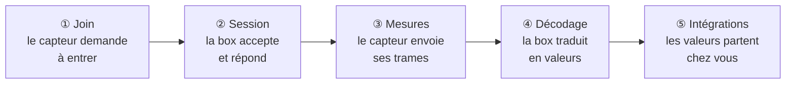

# Mon capteur ne remonte pas

Vous avez déclaré votre capteur dans la box, vous l'avez réveillé… et rien.
Pas une mesure sur votre broker, pas une courbe dans Home Assistant. Ça vous
parle ?

Bonne nouvelle : la box note tout ce qu'elle entend. La page du serveur
intégré (`/lns`) suffit presque toujours à démasquer le coupable, sans console
ni outil spécial. On mène l'enquête ensemble ? C'est parti !

*Page écrite pour le firmware 3.6.6. Elle suppose un capteur déclaré sur le
serveur intégré de la box, comme dans le tuto
[Recevoir les mesures d'un capteur Dragino sur votre broker MQTT](tuto-dragino-vers-broker-mqtt.md).*

## Petit rappel : le parcours d'un capteur

Entre le capteur et vos données, il y a cinq maillons. Chacun laisse une trace
dans la page `/lns`.

| Maillon | Ce qui se passe | La trace dans `/lns` |
|---|---|---|
| ① Join | Le capteur demande à rejoindre le réseau. Sa demande est signée avec son **AppKey** ; la box vérifie la signature. | Carte **Derniers paquets** : une ligne `join` (acceptée) ou `join-fail` (refusée). |
| ② Session | La box attribue au capteur une adresse courte (**DevAddr**) et lui envoie sa réponse. | Carte **Capteurs déclarés** : statut `joined`, colonne DevAddr remplie. |
| ③ Mesures | Le capteur envoie ses trames chiffrées. | Lignes `up` (ou `conf` quand le capteur demande un accusé de réception) ; statut `active`. |
| ④ Décodage | La box déchiffre la trame, puis le décodeur la traduit en valeurs. | Colonne **Décodé**. |
| ⑤ Intégrations | La box pousse les valeurs vers votre broker, votre serveur… | Colonne **Intégr.** : un badge vert par intégration livrée. |

Une panne, c'est un maillon qui casse. Votre enquête consiste à trouver **le
dernier maillon qui fonctionne** : le coupable se cache juste après.

### Les statuts de la carte Capteurs déclarés

| Statut | Ce qu'il veut dire |
|---|---|
| `never` | Déclaré, jamais vu : aucun join réussi, aucune trame. |
| `joined` | La box a accepté le join **et envoyé sa réponse**. Ce n'est pas la preuve que le capteur l'a reçue ! Aucune mesure pour l'instant. |
| `active` | Au moins une trame reçue et déchiffrée. |

### Les types de la carte Derniers paquets

| Type | Ce qu'il veut dire |
|---|---|
| `join` | Demande de join acceptée : la box a répondu. |
| `join-fail` | Demande de join refusée. |
| `up`, `conf` | Trame d'un capteur déclaré, déchiffrée par la box. |
| `down` | Trame envoyée par la box au capteur : commande, accusé de réception, réglage radio. |
| `relayé`, `ignoré` | Trame d'un capteur que la box ne connaît pas. Elle part vers le serveur externe s'il est allumé (`relayé`), sinon elle est laissée de côté (`ignoré`). |

### La trousse de l'enquêteur

| Outil | À quoi il sert |
|---|---|
| Filtre **Device** | N'afficher qu'un capteur. Il ne propose que les capteurs qui ont déjà une adresse : un capteur `never` n'y figure pas, et les lignes `join-fail` (qui n'ont pas d'adresse) disparaissent dès qu'un capteur est choisi. |
| Filtre **Type** | `join` affiche les `join` et les `join-fail` ; `uplink` les `up` et les `conf` ; `décodé` les trames dont le décodeur a tiré des valeurs ; `non décodé` les lignes `relayé` et `ignoré`. |
| Filtre **Nb** | 20 lignes par défaut, jusqu'à 200 sur une box avec PSRAM. |
| Champ **Rechercher** | En haut de la page. Filtre toutes les cartes sur un nom, un DevEUI ou un morceau de payload. Le plus court chemin vers les `join-fail` d'un capteur. |

La page se rafraîchit toute seule toutes les 5 secondes : gardez-la ouverte
pendant que vous manipulez le capteur.

> [!WARNING]
> **Le piège : le filtre `non décodé`.** Il n'affiche pas les trames `up`
> restées sans valeurs, mais les lignes `relayé` et `ignoré` des capteurs non
> déclarés. Pour retrouver un `up` mal décodé, choisissez `uplink` et lisez la
> colonne Décodé.

> [!TIP]
> Sur un Dragino déjà joint, un appui court (de 1 à 3 secondes) sur le bouton
> **ACT** envoie une trame tout de suite
> ([documentation Dragino du S31-LB](https://wiki.dragino.com/docs/LoRaWAN-End-Node/temperature-humidity-sensors/s31-lb/)).
> Idéal pour voir « sa » ligne apparaître sans attendre la prochaine mesure.

## Aiguillage : par quelle fiche commencer ?

| Ce que vous voyez dans la page `/lns` | Allez à |
|---|---|
| Statut `never`, aucune ligne pour ce capteur, pas même un `join-fail` | [Fiche 1 : le capteur est muet](#fiche-1--le-capteur-est-muet) |
| Des lignes `join-fail` au nom du capteur, statut bloqué sur `never` | [Fiche 2 : des join-fail en rafale](#fiche-2--des-join-fail-en-rafale) |
| Statut `joined`, Rx à `0`, et des lignes `join` qui reviennent | [Fiche 3 : joined sans aucune mesure](#fiche-3--joined-sans-aucune-mesure) |
| Une ligne `relayé` ou `ignoré` apparaît chaque fois que votre capteur émet | [Fiche 4 : des trames relayées ou ignorées](#fiche-4--des-trames-relayées-ou-ignorées) |
| Des lignes `up`, mais la colonne Décodé est vide ou commence par ⚠ | [Fiche 5 : des trames up sans valeurs](#fiche-5--des-trames-up-sans-valeurs) |
| Des valeurs décodées, mais rien n'arrive chez vous | [Fiche 6 : décodé dans la box mais rien chez vous](#fiche-6--décodé-dans-la-box-mais-rien-chez-vous) |
| Un capteur `active` qui se tait par moments ou finit par décrocher, loin de la box | [Fiche 7 : le capteur lointain qui décroche](#fiche-7--le-capteur-lointain-qui-décroche) |

## Fiche 1 : le capteur est muet

**Symptôme**

Dans **Capteurs déclarés**, le statut reste à `never`, la colonne DevAddr
affiche `-` et Rx `0`. Dans **Derniers paquets**, aucune ligne à son nom, pas
même un `join-fail`.

**Enquête**

Pour la box, ce capteur n'existe pas : elle n'a reçu aucune demande de join
qu'elle sache lui rattacher. Trois questions, dans l'ordre :

1. **Le serveur intégré tourne-t-il ?** Le badge à côté du titre de la page
   doit afficher `Serveur intégré (local)`. S'il affiche `Serveur externe`, la
   box relaie tout vers le serveur externe et ne traite aucun capteur déclaré.
2. **La box écoute-t-elle la bonne bande ?** La ligne grise sous le titre
   indique le plan, par exemple `Plan US915 · sous-bande 2 (ChirpStack us915_1)`.
   Si elle ajoute « plan non pris en charge par le serveur intégré », le
   serveur intégré ne gère pas votre plan : il fonctionne en EU868, US915 et
   AU915 seulement.
3. **La box entend-elle quoi que ce soit ?** Filtres Device et Type sur
   `tous`. Des lignes `relayé` ou `ignoré` venues d'autres capteurs (ceux des
   voisins comptent !) prouvent que la radio de la box fonctionne. Table vide
   depuis longtemps ? Sur la page de configuration, le voyant **Serveur
   intégré** passe à l'orange avec le message « Aucune trame LoRa reçue depuis
   plus de 24 h (antenne/RF ?) ».

Ensuite, réveillez le capteur sous vos yeux : filtre Type sur `join`, appui de
plus de 3 secondes sur **ACT**, et surveillez la table.

**Coupable**

| Suspect | L'indice |
|---|---|
| Le capteur dort | Les Dragino de la série LB sont livrés endormis : sans appui long sur ACT, ils n'émettent rien. |
| La pile | La LED ne réagit pas à l'appui sur ACT. |
| La bande | Un capteur EU868 ne parle pas à une box US915, et inversement. Chez Dragino, la bande est fixée à la fabrication : c'est la référence achetée qui compte. |
| La sous-bande (US915, AU915) | Dans ces plans, la box n'écoute que 8 canaux, une « sous-bande » parmi 8. Le capteur doit émettre dans la même. |
| Le DevEUI | La box ignore **sans laisser de trace** la demande de join d'un DevEUI qu'elle ne connaît pas. Un seul caractère faux suffit. |
| Le JoinEUI | S'il est rempli et ne correspond pas à celui du capteur : même silence qu'avec un DevEUI faux. |
| La portée | Capteur trop loin, antenne mal vissée ou abîmée, côté capteur comme côté box. |
| Le serveur éteint | Badge `Serveur externe` (question 1). |

> [!WARNING]
> **Le piège : la numérotation des sous-bandes.** Le même bloc de 8 canaux
> porte deux numéros. Côté capteur (Dragino, console TTN, la plupart des
> fabricants), on compte de **1 à 8**. Côté ChirpStack, de **0 à 7**. La
> sous-bande 2 d'un capteur s'appelle donc `us915_1` chez ChirpStack. Se
> tromper d'un cran ne donne **aucun message d'erreur** : la box écoute
> simplement à côté. Heureusement, la ligne grise de `/lns` affiche les deux
> numéros.

**Solution**

| Suspect | Solution |
|---|---|
| Le capteur dort | Appui de plus de 3 secondes sur ACT : la LED verte clignote vite 5 fois, puis le capteur tente son join. S'il réussit, la LED verte reste allumée 5 secondes. |
| La pile | Changez-la, puis recommencez l'appui long. |
| La bande | Il faut un capteur de la même bande que la box. |
| La sous-bande | Réglez le capteur sur la sous-bande affichée par la ligne grise (chez Dragino : commande AT `AT+CHE`, numérotée de 1 à 8). Les capteurs préréglés pour TTN arrivent souvent en sous-bande 2. Vous pouvez aussi régler la box sur la sous-bande du capteur (page de configuration, réglages système : **Plan de fréquence** puis **Sous-bande**), mais alors tous vos capteurs doivent suivre. |
| Le DevEUI, le JoinEUI | Cliquez sur le DevEUI dans Capteurs déclarés : le capteur revient dans le formulaire. Comparez caractère par caractère avec l'étiquette, **videz le JoinEUI**, puis **Mettre à jour**. |
| La portée | Faites le premier essai dans la même pièce que la box, et vérifiez les antennes. |
| Le serveur éteint | Page de configuration, carte **Serveur réseau**, bouton **Serveur LoRaWAN intégré** (voir l'[étape 1 du tuto Dragino](tuto-dragino-vers-broker-mqtt.md#étape-1--activer-le-serveur-intégré)). |

> [!IMPORTANT]
> **Le bon réglage : le premier join se fait à côté de la box.** Un capteur
> qui rejoint dans la même pièce met hors de cause d'un seul coup la bande, la
> sous-bande et les clés. Installez-le ensuite à sa place définitive : s'il
> décroche là-bas, c'est la portée ([fiche 7](#fiche-7--le-capteur-lointain-qui-décroche)).

## Fiche 2 : des join-fail en rafale

**Symptôme**

À chaque tentative du capteur, une ligne `join-fail` à son nom : DevAddr `-`,
Payload vide, mais RSSI et SF renseignés. Le statut reste à `never`.

**Enquête**

Commençons par la bonne nouvelle : la box entend le capteur et reconnaît son
DevEUI. Radio, bande, sous-bande et DevEUI sont hors de cause. Ce qui coince,
c'est la signature : la demande de join est signée avec l'AppKey du capteur, et
la box la vérifie avec l'AppKey que vous avez saisie.

Pour afficher ces lignes : Device sur `tous` (le filtre Device masque les
`join-fail`), Type sur `join`, ou le nom du capteur dans **Rechercher**. Puis
regardez la suite :

| Ce que vous voyez | Suspect |
|---|---|
| Des `join-fail`, encore et toujours | L'AppKey |
| Quelques `join-fail`, puis un `join` | Le compteur du capteur |
| Un seul `join-fail`, à la même seconde qu'un `join` | Un doublon |

**Coupable**

1. **L'AppKey**, le grand classique : une faute de frappe, ou un capteur
   reprogrammé avec une autre clé, par exemple pour un ancien serveur. C'est la
   clé que le capteur a en mémoire qui compte, pas celle de l'étiquette.
2. **Le compteur du capteur.** Chaque demande de join porte un numéro qui doit
   toujours augmenter, et la box refuse un numéro déjà utilisé (c'est une
   protection contre les rejeux). Un capteur qui a perdu sa mémoire repart en
   arrière et se fait refuser.
3. **Un doublon** : la même demande captée deux fois, par exemple quand le
   capteur est tout près de la box. La première est acceptée, la copie refusée.

**Solution**

1. AppKey : cliquez sur le DevEUI dans Capteurs déclarés, ressaisissez
   l'AppKey (32 caractères hexadécimaux), **Mettre à jour**, puis appui de plus
   de 3 secondes sur ACT.
2. Compteur : rien à faire. Après quatre demandes différentes en moins de dix
   minutes, la box se recale d'elle-même sur le nouveau compteur et accepte le
   join.
3. Doublon : rien à faire, le capteur a bien rejoint.

## Fiche 3 : joined sans aucune mesure

**Symptôme**

Statut `joined` et DevAddr attribuée, mais Rx reste à `0` et Vu à `-`. Dans
Derniers paquets, des lignes `join` reviennent à chaque tentative, souvent avec
un SF qui grimpe d'une fois sur l'autre.

**Enquête**

Spoiler : `joined` ne veut pas dire « le capteur a rejoint le réseau ». Ça veut
dire « la box a accepté la demande et envoyé sa réponse ». Si le capteur
redemande, c'est qu'il n'a pas reçu cette réponse, ou qu'il l'a refusée. Alors
il réessaie en ralentissant (SF plus élevé) pour porter plus loin.

Deux indices à relever :

- **Côté capteur** : un Dragino qui a réussi son join allume sa LED verte fixe
  5 secondes. Pas de LED verte fixe, pas de join.
- **Côté box** : une pastille `RX2` à côté du statut signale que la box a jugé
  le lien faible et répond par la fenêtre de secours (voir la solution).

**Coupable**

1. **La réponse ne porte pas jusqu'au capteur.** La box entend souvent plus
   loin que le capteur : ses trames arrivent, mais il n'entend pas la réponse.
   Le grand classique en limite de portée.
2. **Un capteur d'occasion**, passé par un autre réseau, peut refuser la
   réponse de la box.
3. **Le capteur est aussi déclaré ailleurs** (TTN, ChirpStack) et a gardé la
   réponse de l'autre serveur. Indice : des lignes `relayé` ou `ignoré`
   apparaissent quand il émet.
4. **Fausse alerte : la box vient de redémarrer.** Elle conserve les sessions
   des capteurs, mais le statut repart de `joined` jusqu'à leur trame suivante.
   Si aucune ligne `join` n'apparaît, tout va bien.

**Solution**

1. Portée : la box se débrouille d'abord toute seule. Quand le lien est faible,
   elle répond une tentative sur deux dans la fenêtre de secours **RX2** : SF12,
   pleine puissance, 869,525 MHz en EU868 et 923,3 MHz en US915/AU915. La
   pastille `RX2` le signale, et les commandes envoyées plus tard au capteur
   passeront par le même chemin. Laissez passer quelques tentatives. Si rien
   n'y fait, rapprochez le capteur de la box et vérifiez ses antennes.
2. Capteur d'occasion : la box repère ces join sans lendemain et ajuste sa
   réponse d'elle-même au fil des tentatives. Patience, et supprimez le capteur
   de son ancien serveur.
3. Déclaré ailleurs : direction la
   [fiche 4](#fiche-4--des-trames-relayées-ou-ignorées).
4. Après un redémarrage : un appui court sur ACT (1 à 3 secondes) envoie une
   trame ; une ligne `up` arrive et le statut passe à `active`.

> [!NOTE]
> La réponse de secours RX2 pour les capteurs éloignés est arrivée avec la
> version 3.5.10. Si votre box est plus ancienne, une mise à jour s'impose :
> voir le [journal des versions](../../CHANGELOG.md).

## Fiche 4 : des trames relayées ou ignorées

**Symptôme**

Chaque fois que votre capteur émet, une ligne `relayé` ou `ignoré` apparaît,
avec Device `-`, Port `-` et un Payload illisible. Dans Capteurs déclarés, le
capteur reste en `never` ou en `joined`, avec Rx à `0`.

**Enquête**

Ces lignes sont des trames bien reçues, mais dont l'adresse (DevAddr) ne
correspond à aucun capteur de la box. Elle ne peut pas les déchiffrer : elle
les transmet au serveur externe s'il est allumé (`relayé`), sinon elle les
laisse de côté (`ignoré`).

Attention, la box affiche tout ce qu'elle entend, y compris les capteurs des
voisins. Pour être sûr que la ligne est bien la vôtre :

1. Filtre Type sur `non décodé` : il ne reste que les lignes `relayé` et
   `ignoré`.
2. Appui court sur ACT (1 à 3 secondes). La ligne qui apparaît dans les
   secondes suivantes est la vôtre : notez son DevAddr.
3. Comparez avec la colonne DevAddr de Capteurs déclarés. Un `-` ou une autre
   adresse : la box et le capteur ne partagent pas la même session.

**Coupable**

Le capteur a bien une session ouverte… mais pas avec la box.

| Suspect | L'indice |
|---|---|
| Il est resté sur son ancien réseau | Il avait rejoint TTN ou ChirpStack auparavant, et il continue d'émettre avec cette session sans redemander de join. Si cet ancien serveur est votre serveur externe, il reçoit toujours ses trames (`relayé`) : voilà pourquoi rien ne semblait cassé de ce côté-là. |
| Il est déclaré des deux côtés | Deux serveurs lui ont répondu avec des clés différentes, et il a gardé celle de l'autre. |
| Vous l'avez modifié ou redéclaré dans la box | **Mettre à jour** dans le formulaire remplace les clés et efface la session : le statut revient à `never`, et les trames envoyées avec l'ancienne adresse deviennent étrangères. |
| Son DevEUI est mal saisi | La box ignore ses demandes de join en silence ([fiche 1](#fiche-1--le-capteur-est-muet)) ; s'il garde une session ailleurs, ses trames atterrissent ici. |

**Solution**

1. Supprimez le capteur de tout autre serveur (TTN, ChirpStack…) : un capteur
   se déclare à **un seul** endroit.
2. Vérifiez son DevEUI dans la box.
3. Forcez un nouveau join : appui de plus de 3 secondes sur ACT. Vous devez
   voir passer une ligne `join`, puis des lignes `up` au nom du capteur.

> [!WARNING]
> **Le piège : « Mettre à jour » relance le join.** Corriger un nom ou une clé
> dans le formulaire efface la session du capteur : forcez un join juste après.
> Le décodeur, la classe et l'historique, eux, se changent directement dans le
> tableau, sans toucher à la session.

## Fiche 5 : des trames up sans valeurs

**Symptôme**

Des lignes `up` arrivent, le statut est `active`, la colonne Payload est
remplie… mais Décodé reste vide ou commence par ⚠. Sur votre broker, le champ
`data` est là, mais pas `decoded`.

**Enquête**

Capteur, radio et clés vont bien : seul le dernier mot manque. Filtre Type sur
`uplink`, puis lisez les colonnes Décodé et Port.

| Colonne Décodé | Ce que ça veut dire | Grave ? |
|---|---|---|
| Vide | Aucun décodeur n'est affecté au capteur. | Oui : voir la solution. |
| `⚠ <décodeur> : trame non reconnue (port N, M o)` | Le décodeur ne sait pas lire cette trame : ce n'est pas le bon modèle, ou ce port lui est inconnu. | Oui, si c'est le port des mesures. |
| `commandes MAC (port 0, M o)` | Une trame de service du réseau, sans mesure. | Non, c'est normal. |
| `statut fabricant (port N, M o)` | Une trame d'état d'un capteur SenseCAP. | Non. |
| `modele`, `fw`, `bande`, `sous_bande`, `bat` | La trame d'état d'un Dragino (port 5) : pas de température, mais la bande, la sous-bande et la tension de la pile. | Non, et bien pratique pour surveiller la pile. |
| Vide, avec Port `-` et Payload vide | Une trame sans données. | Non. |

Repère utile : les Dragino envoient leurs mesures sur le **port 2**.

**Coupable**

1. Aucun décodeur n'est affecté au capteur.
2. Le décodeur choisi est celui d'un modèle voisin.
3. Votre décodeur personnalisé est mal réglé : positions des octets, ou port.

**Solution**

1. Carte Capteurs déclarés, colonne **Décodeur** : choisissez le modèle. Effet
   immédiat : la colonne Décodé relit aussitôt les trames déjà affichées avec
   le nouveau décodeur, sans nouveau join. Vos intégrations, elles, reçoivent
   les valeurs à partir de la trame suivante.
2. Votre modèle n'est pas dans la liste ? Créez votre décodeur dans la carte
   **Décodeurs**. Collez la colonne Payload d'une vraie trame dans le bloc de
   son port, puis cliquez sur **Tester via la box** : vous voyez ce que la box
   en tire réellement.
3. Décodeur personnalisé : renseignez le **FPort** de chaque champ. Un champ
   sans port s'applique à toutes les trames, et une trame de service pourrait
   alors être lue comme une mesure et publier des valeurs fausses.

> [!TIP]
> Un ⚠ qui annonce pile `32 o` ? Pour son affichage, la page ne garde que les
> 32 premiers octets de chaque trame. Sur une trame plus longue, la colonne
> Décodé peut se tromper alors que vos intégrations reçoivent la trame
> entière : regardez votre broker avant de toucher au décodeur.

## Fiche 6 : décodé dans la box mais rien chez vous

**Symptôme**

La colonne Décodé affiche vos mesures, mais votre broker, Home Assistant ou
ThingsBoard ne reçoit rien.

**Enquête**

Tout se lit dans la colonne **Intégr.** de la ligne :

| Colonne Intégr. | Ce que ça veut dire |
|---|---|
| Vide | Aucune intégration n'était visée : il n'y en a pas, ou le **Groupe** du capteur ne figure pas dans les **Groupes** de l'intégration. |
| Badge vert | Livré à l'intégration de ce numéro (colonne N° de la carte Intégrations). |
| Badge rouge | Échec. Survolez le badge : la raison s'affiche. |

La carte **Intégrations** donne le même verdict dans sa colonne **État**, et
son bouton **test** envoie un message d'essai. Voici les messages d'échec que
vous pouvez y lire :

| Message | Coupable probable |
|---|---|
| `MQTT non connecté (broker ?)` | La connexion n'est pas encore établie : test lancé trop tôt, ou broker absent. |
| `broker injoignable (TCP)` | Adresse ou port faux, broker arrêté, pare-feu, ou box sans accès au réseau du broker. |
| `authentification refusée (token ?)` | Identifiant et mot de passe, ou jeton ThingsBoard, refusés. |
| `connexion refusée par le broker` | Le broker refuse la connexion pour une autre raison : son journal vous la donnera. |
| `HTTP 401`, `HTTP 404`, `HTTP 500`… | Webhook : le serveur a répondu par une erreur. 4xx : requête refusée (authentification, chemin) ; 5xx : panne côté serveur. |
| `heap interne insuffisant`, `client MQTT KO (heap ?)` | La box manque de mémoire pour cette intégration (surtout les anciens modèles sans PSRAM). |

**Coupable**

1. **Le test trop tôt** : la connexion à un broker met une vingtaine de
   secondes à s'établir.
2. **Une adresse ou des identifiants faux.**
3. **Les groupes** : capteur en groupe `B`, intégration réservée au groupe `A`.
4. **Le mauvais abonnement** : badge vert, et pourtant rien. La box publie
   sur `<Topic>/<DevEUI>/up`, soit `lns/<DevEUI>/up` avec le Topic par défaut.
   En Auto Discovery (Home Assistant, Domoticz), les états partent sur
   `awaro/<DevEUI>/state` et les annonces sous `homeassistant/…`.
5. **La mémoire** : sur un modèle sans PSRAM, une seule connexion MQTT à la
   fois (MQTT, ThingsBoard ou Auto Discovery). La carte Intégrations l'indique
   en orange.
6. **Une coupure réseau** : sans historique, les trames reçues pendant la
   coupure sont perdues pour vos intégrations.

**Solution**

1. Patientez une vingtaine de secondes après l'ajout, puis **test**.
2. Bouton **modifier** de l'intégration : corrigez, puis **Mettre à jour**. Un
   identifiant ou un mot de passe laissé vide garde l'ancienne valeur.
3. Videz le champ **Groupes** de l'intégration : vide veut dire « tous les
   capteurs ».
4. Abonnez-vous large pour voir passer tout ce que la box publie, par exemple
   `mosquitto_sub -h <broker> -t 'lns/#' -v` (voir
   l'[étape 5 du tuto Dragino](tuto-dragino-vers-broker-mqtt.md#étape-5--vérifier-sur-le-broker)).
5. Sans PSRAM : gardez une seule intégration MQTT. Les webhooks HTTP, plus
   légers, ne demandent pas de connexion permanente.
6. Coupures : voir le bon réglage ci-dessous.

> [!IMPORTANT]
> **Le bon réglage : l'Historique à `100`.** Dans Capteurs déclarés, colonne
> Historique, passez vos capteurs à `100`. Après une coupure réseau, la box
> rejoue alors les trames non livrées à la reconnexion (une trame toutes les
> 500 ms, marquées `"replay":true`). L'Auto Discovery n'est pas rejoué : il ne
> publie que l'état courant.

## Fiche 7 : le capteur lointain qui décroche

**Symptôme**

Le capteur est `active`, mais la colonne Vu dépasse largement son rythme
d'émission habituel, des numéros manquent dans FCnt, ou il a fini par se taire.
Il est loin de la box, et ses trames arrivent avec un RSSI très négatif et un
SF élevé.

**Enquête**

Filtre Device sur le capteur, Nb au maximum, et lisez trois colonnes :

| Colonne | Ce qu'elle raconte |
|---|---|
| **FCnt** | Le capteur numérote chaque trame. Un trou (41, 42, 45) : deux trames que la box n'a pas entendues. |
| **RSSI** | La puissance reçue en dBm : plus proche de 0, meilleur signal. À −115 dBm ou moins, la box considère d'office le lien comme faible. |
| **SF** | Le facteur d'étalement : SF7 est rapide, SF12 lent mais porte plus loin. Un capteur qui monte en SF cherche à se faire entendre. |

Ajoutez la pastille `RX2` dans la colonne Statut : la box a jugé le lien faible
et répond à ce capteur par la fenêtre de secours. Pour un suivi sur plusieurs
jours, passez l'**Historique** du capteur à `100` ou `1000`, puis téléchargez
le CSV avec le bouton ⇩.

**Coupable**

1. **La limite de portée** : distance, obstacles, antenne.
2. **La pile en fin de vie** : sur un Dragino, la trame d'état (port 5) donne
   la tension dans `bat`.
3. **En AU915, une box antérieure à la 3.6.3** : elle pouvait demander à un
   capteur de passer en SF11, une vitesse que ce plan interdit, et le capteur
   restait muet jusqu'à son redémarrage
   ([journal des versions](../../CHANGELOG.md)).

**Solution**

Ce que la box fait seule, sans réglage :

- elle ajuste la vitesse (SF) de chaque capteur d'après la qualité de ses
  trames : plus rapide quand la marge le permet, plus lent quand elle manque,
  mais jamais plus lent que SF11 en EU868 ni que SF10 en US915/AU915 ;
- elle répond aux capteurs mal reçus par la fenêtre de secours RX2, en SF12 et
  à pleine puissance.

Ce qui vous revient :

1. Rapprochez le capteur ou la box, vérifiez les antennes, et comparez le RSSI
   avant et après chaque déplacement.
2. Changez la pile si `bat` baisse.
3. En AU915 : mettez la box à jour, puis redémarrez le capteur pour qu'il
   refasse son join.

> [!TIP]
> Avant de déplacer quoi que ce soit, faites le test inverse : posez le capteur
> à côté de la box. S'il y remonte parfaitement, la radio et les clés sont hors
> de cause : c'est bien la portée.

## En résumé

- Remontez le parcours **join → session → mesures → décodage → intégrations**
  et cherchez le dernier maillon qui marche.
- `never` sans aucune ligne : la box n'entend pas le capteur, ou ne le
  reconnaît pas. Vérifiez le serveur intégré, la bande, la sous-bande, le
  DevEUI et la pile.
- `join-fail` : c'est l'AppKey. `joined` avec des `join` qui reviennent : la
  réponse ne parvient pas au capteur.
- `relayé` ou `ignoré` : le capteur a une session ailleurs. Un seul serveur,
  puis un nouveau join.
- Décodé vide ou ⚠ : c'est le décodeur. Badge Intégr. rouge : survolez-le, il
  donne la raison.
- Loin de la box : FCnt, RSSI et SF racontent la portée. La box s'adapte
  seule ; l'antenne et l'emplacement, c'est pour vous.

Et vous, sur quel maillon votre capteur avait-il calé ? Racontez-le nous, ou
signalez un cas que cette page ne couvre pas, dans les
[issues du dépôt](https://github.com/Di-Ny/awaro/issues).
