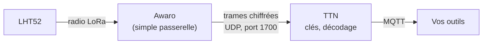
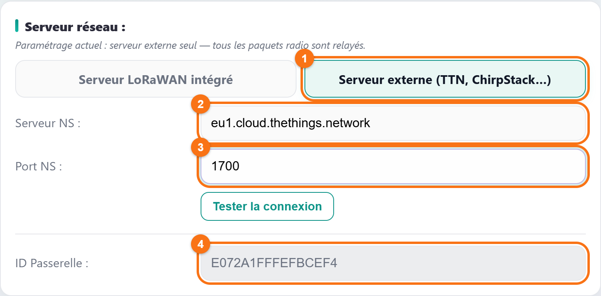
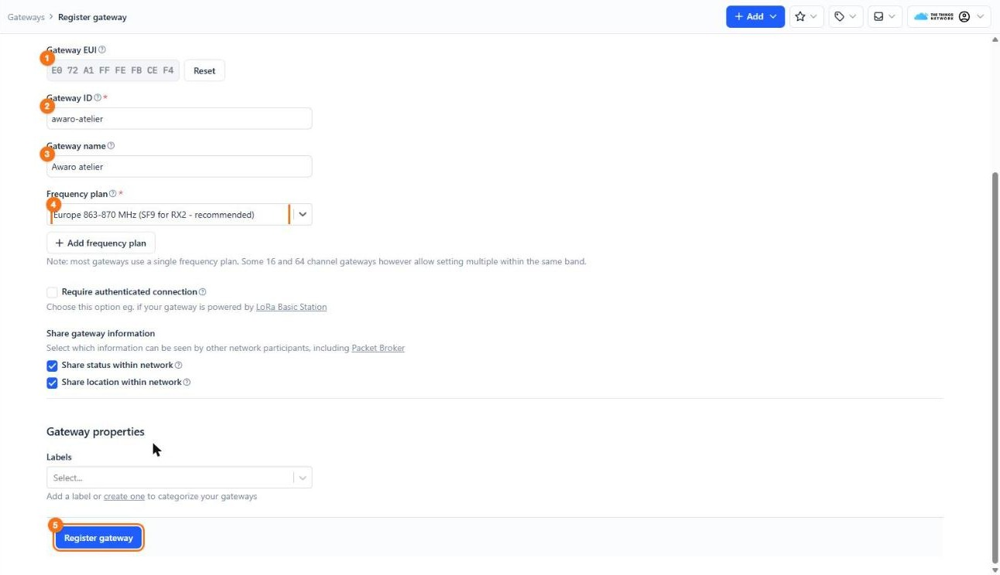
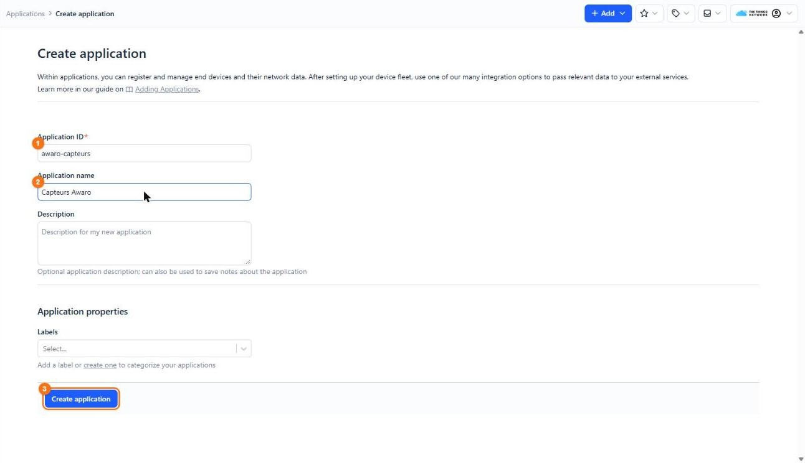
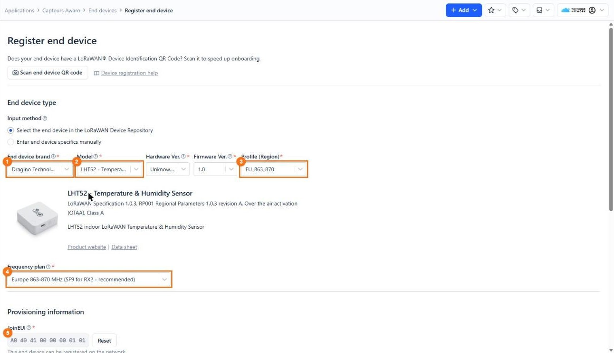
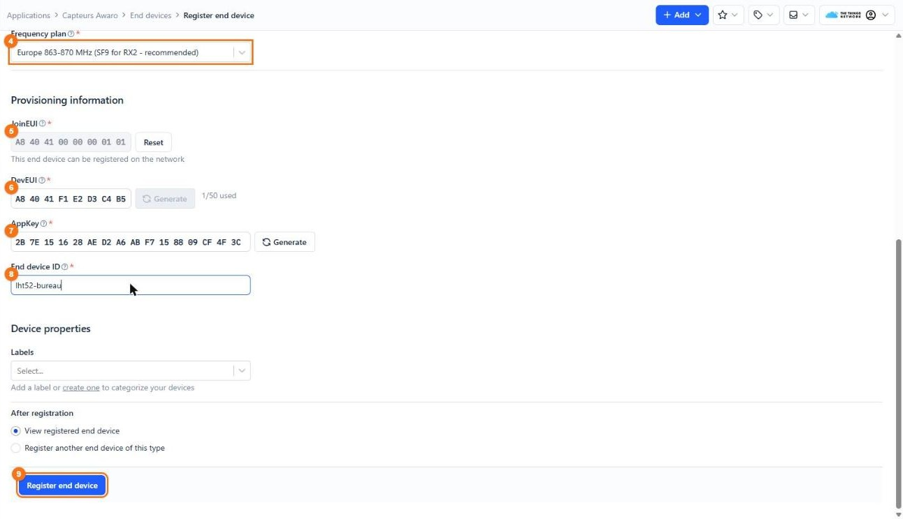
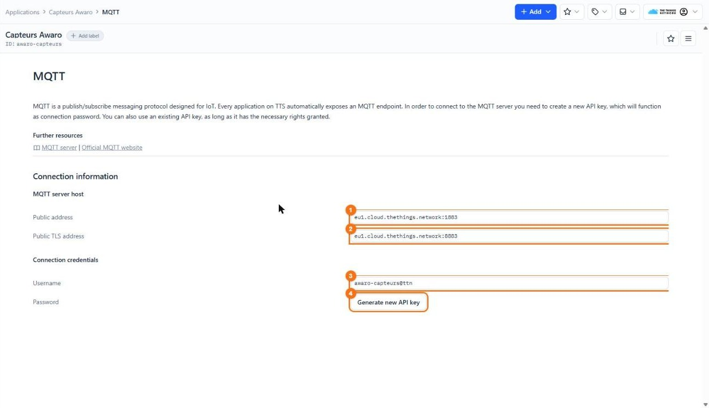

# Récupérer les mesures de vos capteurs sur TTN (The Things Network)

Vous avez déjà vos capteurs sur TTN, ou vous voulez que plusieurs passerelles
d'un même site travaillent ensemble ? Dans ce cas, la box Awaro n'a pas besoin
de son serveur intégré : elle devient une **passerelle TTN**. Elle relaie les
trames radio, et c'est TTN qui gère les capteurs, décode leurs mesures et vous
les livre.

Dans ce tuto, on va jusqu'au bout de la chaîne : la box déclarée sur TTN, un
capteur Dragino **LHT52** (température et humidité) enregistré, et ses mesures
lues en MQTT chez TTN. Prêt ? C'est parti !

*Captures réalisées avec la console TTN (cluster Europe, `eu1`) et la page de
configuration d'une box Awaro en firmware 3.6.6. Les pastilles orange
numérotées renvoient aux tableaux sous chaque capture.*

## Petit rappel : qui fait quoi ?



| Rôle | Qui le tient ici |
|---|---|
| Écouter la radio | La box Awaro. |
| Détenir les clés du capteur, déchiffrer, décoder | TTN. |
| Livrer les mesures à vos outils | TTN (intégration MQTT, webhooks…). |

La box ne voit que des trames chiffrées : tout se déclare dans la console TTN.
Pour comparer avec le serveur intégré, voyez la description
[Serveur LoRaWAN intégré ou serveur externe : lequel choisir ?](description-serveur-integre-ou-externe.md).

## Ce qu'il vous faut

- un compte TTN gratuit sur [The Things Network](https://www.thethingsnetwork.org/),
  et sa console Europe : <https://eu1.cloud.thethings.network/console> ;
- une box **Awaro** connectée à Internet ;
- un capteur **Dragino LHT52** réglé sur la bande EU868, avec l'étiquette de ses
  clés (DevEUI, AppEUI, AppKey) livrée dans la boîte ;
- un client MQTT pour lire les mesures : `mosquitto_sub`, ou
  [MQTT Explorer](https://mqtt-explorer.com/).

## Étape 1 : régler la box en serveur externe

Ouvrez la page de configuration de la box (`http://<adresse-de-la-box>/`),
carte **Serveur réseau**.



*La box réglée pour relayer vers TTN : le serveur externe est allumé, le
serveur intégré éteint.*

| Repère | Élément | À quoi il sert | Dans ce tuto |
|---|---|---|---|
| — | Ligne grise sous le titre | Résume le réglage en cours. | Doit indiquer « serveur externe seul ». |
| — | Bouton **Serveur LoRaWAN intégré** | Le serveur intégré de la box. | **Éteint**. |
| 1 | Bouton **Serveur externe (TTN, ChirpStack…)** | Relaie toutes les trames radio vers un serveur LoRaWAN externe. | **Allumé**. |
| 2 | **Serveur NS** | L'adresse du serveur externe. | `eu1.cloud.thethings.network` (cluster Europe de TTN). |
| 3 | **Port NS** | Le port UDP du serveur. | `1700`. |
| — | **Tester la connexion** | Vérifie que le serveur répond, sans rien enregistrer. | Voir ci-dessous. |
| 4 | **ID Passerelle** | L'identifiant unique de la box (Gateway EUI), en lecture seule. | **Recopiez-le** : TTN vous le demandera à l'étape 2. |

Les deux boutons s'appliquent dès le clic. L'adresse et le port, eux,
s'enregistrent avec le bouton **Appliquer et redémarrer**, en bas de la page.

Avant de redémarrer, cliquez sur **Tester la connexion**. Le message
« Serveur joint — PULL_ACK reçu en … ms » confirme que TTN répond. « DNS OK
mais aucun PULL_ACK sous 3 s » signale un port faux ; « Échec DNS » une adresse
mal saisie ou une box sans Internet.

> [!NOTE]
> Les champs **Serveur NS 2** et **Port NS 2**, visibles en **Paramétrage
> avancé**, envoient les mêmes trames vers un second serveur. Laissez-les vides.

> [!WARNING]
> **Attention à la concurrence !** Si vous laissez aussi le serveur intégré
> allumé, les capteurs déclarés dans la box ne partent **pas** vers TTN : ils
> restent traités par la box. Un capteur ne se déclare qu'à un seul endroit.

## Étape 2 : déclarer la passerelle sur TTN

Dans la console TTN : **Gateways**, puis **+ Register gateway**. Saisissez le
**Gateway EUI** et cliquez sur **Confirm** : la suite du formulaire apparaît.



*Le formulaire de TTN rempli pour la box : l'EUI est l'ID Passerelle de l'étape 1.*

| Repère | Champ | Ce que vous saisissez | Obligatoire ? |
|---|---|---|---|
| 1 | **Gateway EUI** | L'**ID Passerelle** de la box (étape 1, repère 4). | Oui |
| 2 | **Gateway ID** | Un identifiant unique sur TTN : minuscules, chiffres et tirets, par exemple `awaro-atelier`. Il ne se change plus ensuite. | Oui |
| 3 | **Gateway name** | Un nom libre, par exemple `Awaro atelier`. | Non |
| 4 | **Frequency plan** | `Europe 863-870 MHz (SF9 for RX2 - recommended)`, le plan conseillé par TTN en Europe. | Oui |
| — | **+ Add frequency plan** | Ajoute un second plan, pour les passerelles 16 ou 64 canaux. | Inutile : la box en a 8. |
| — | **Require authenticated connection** | Réservé aux passerelles LoRa Basic Station. La box parle le protocole UDP de Semtech. | **Décoché**. |
| — | **Share status / location within network** | Rend visibles l'état et la position de la passerelle pour les autres utilisateurs. | Au choix. |
| — | **Labels** | Des étiquettes pour ranger vos passerelles. | Facultatif. |
| 5 | **Register gateway** | Enregistre la passerelle. | — |

Une fois la box redémarrée (étape 1), la page de la passerelle sur TTN passe
à l'état connecté en quelques minutes.

## Étape 3 : créer une application

Une application TTN regroupe vos capteurs et leurs intégrations. **Applications**,
puis **+ Create application**.



*Une application pour ranger les capteurs du site.*

| Repère | Champ | Ce que vous saisissez | Obligatoire ? |
|---|---|---|---|
| 1 | **Application ID** | Un identifiant unique sur TTN : minuscules, chiffres et tirets, par exemple `awaro-capteurs`. Il servira d'identifiant MQTT à l'étape 6. | Oui |
| 2 | **Application name** | Un nom libre, par exemple `Capteurs Awaro`. | Non |
| — | **Description** | Une note libre. | Non |
| — | **Labels** | Des étiquettes pour ranger vos applications. | Non |
| 3 | **Create application** | Crée l'application. | — |

## Étape 4 : déclarer le capteur

Dans l'application : **End devices**, puis **+ Register end device**. Le
formulaire se remplit en deux temps.

**Le type de capteur**, choisi dans le registre des fabricants (LoRaWAN Device
Repository) :



*Le LHT52 choisi dans le registre : TTN connaît ses paramètres radio.*

| Repère | Champ | Ce que vous saisissez | Obligatoire ? |
|---|---|---|---|
| — | **Input method** | `Select the end device in the LoRaWAN Device Repository` : TTN connaît alors les paramètres du capteur. L'autre choix, `Enter end device specifics manually`, sert aux capteurs absents du registre. | Oui |
| 1 | **End device brand** | `Dragino Technology`. | Oui |
| 2 | **Model** | `LHT52 - Temperature & Humidity Sensor`. | Oui |
| — | **Hardware Ver.** | La version matérielle, si elle est proposée ; sinon la valeur par défaut. | Oui |
| — | **Firmware Ver.** | La version du firmware du capteur ; en cas de doute, la valeur proposée. | Oui |
| 3 | **Profile (Region)** | `EU_863_870`. | Oui |
| 4 | **Frequency plan** | Le même que la passerelle : `Europe 863-870 MHz (SF9 for RX2 - recommended)`. | Oui |

**Les clés du capteur**, recopiées de son étiquette (cliquez sur **Confirm**
après le JoinEUI pour faire apparaître la suite) :



*Les clés d'exemple saisies ; les vôtres sont sur l'étiquette du capteur.*

| Repère | Champ | Ce que vous saisissez | Obligatoire ? |
|---|---|---|---|
| 5 | **JoinEUI** | L'**AppEUI** de l'étiquette (TTN l'appelle JoinEUI), puis **Confirm**. | Oui |
| 6 | **DevEUI** | Le **DevEUI** de l'étiquette : 16 caractères, commençant par `A84041` chez Dragino. N'utilisez pas **Generate** : il fabriquerait un identifiant que le capteur ne connaît pas. | Oui |
| 7 | **AppKey** | L'**AppKey** de l'étiquette : 32 caractères. Même remarque pour **Generate**. | Oui |
| 8 | **End device ID** | Un identifiant unique dans l'application, par exemple `lht52-bureau`. | Oui |
| — | **Labels** | Des étiquettes pour ranger vos capteurs. | Non |
| — | **After registration** | Ce que la console affiche ensuite : le capteur créé, ou un nouveau formulaire. | Au choix. |
| 9 | **Register end device** | Enregistre le capteur. | — |

Réveillez ensuite le capteur : d'après la
[documentation Dragino du LHT52](https://wiki.dragino.com/docs/LoRaWAN-End-Node/temperature-humidity-sensors/lht52/),
on insère deux piles AAA et on appuie sur le bouton **reset**. La LED verte
clignote à chaque tentative, puis reste allumée **5 secondes** quand le capteur
a rejoint le réseau. Il envoie ensuite une mesure toutes les **20 minutes**.

> [!WARNING]
> **Le piège : le capteur déclaré deux fois.** Si ce LHT52 était déclaré dans
> le serveur intégré d'une box, supprimez-le là-bas avant de le réveiller.

## Étape 5 : vérifier que les mesures arrivent

Sur la page du capteur, onglet **Live data** : chaque trame apparaît, avec
ses valeurs décodées. Si vous ne voyez que des octets bruts, ouvrez l'onglet
**Payload formatters** du capteur et vérifiez qu'un décodeur y est actif :
celui du fabricant, ou un décodeur JavaScript que vous collez vous-même
(`Custom Javascript formatter`).

## Étape 6 : lire les mesures en MQTT chez TTN

Dans l'application : **Other integrations**, puis **MQTT**.



*Les informations de connexion au serveur MQTT de TTN pour l'application.*

| Repère | Élément | Ce qu'il contient | Dans ce tuto |
|---|---|---|---|
| 1 | **Public address** | Le serveur MQTT de TTN, sans chiffrement : `eu1.cloud.thethings.network:1883`. | Pour un essai sur votre réseau. |
| 2 | **Public TLS address** | Le même serveur, chiffré : `eu1.cloud.thethings.network:8883`. | **Conseillé.** |
| 3 | **Username** | L'identifiant MQTT : l'Application ID suivi de `@ttn`, ici `awaro-capteurs@ttn`. | À recopier. |
| 4 | **Generate new API key** | Crée une clé d'accès, qui sert de mot de passe MQTT. | Cliquez et **copiez la clé aussitôt** : TTN ne la réaffiche plus ensuite. |

Abonnez-vous ensuite aux trames montantes de tous les capteurs de
l'application. D'après la
[documentation MQTT de TTN](https://www.thethingsindustries.com/docs/integrations/other-integrations/mqtt/),
le topic a la forme `v3/<application>@ttn/devices/<capteur>/up` :

```bash
mosquitto_sub -h eu1.cloud.thethings.network -p 8883 --capath /etc/ssl/certs \
  -u 'awaro-capteurs@ttn' -P 'NNSXS.votre-cle-api' \
  -t 'v3/awaro-capteurs@ttn/devices/+/up' -v
```

Chaque message est un JSON détaillé. D'après la
[description des formats de données de TTN](https://www.thethingsindustries.com/docs/integrations/data-formats/),
les champs utiles sont :

| Champ | Ce qu'il contient |
|---|---|
| `end_device_ids.device_id` | L'identifiant du capteur (`lht52-bureau`). |
| `uplink_message.decoded_payload` | Les mesures décodées par TTN. |
| `uplink_message.frm_payload` | La trame brute, en base64. |
| `uplink_message.rx_metadata[].rssi`, `.snr` | La qualité radio, pour chaque passerelle qui a reçu la trame. |

> [!TIP]
> Vous préférez que TTN pousse les mesures vers votre serveur ? Le menu
> **Webhooks** de l'application envoie chaque trame en HTTP, vers n8n, Datacake
> ou votre propre service.

## En résumé

- En mode **serveur externe**, la box n'est qu'une passerelle : capteurs,
  clés et décodage vivent chez TTN.
- Côté box : serveur externe allumé, `eu1.cloud.thethings.network`, port `1700`,
  puis **Appliquer et redémarrer**. Recopiez l'**ID Passerelle**.
- Côté TTN : la passerelle avec cet EUI, une application, le capteur choisi
  dans le registre avec les clés de son étiquette.
- Les mesures se lisent sur le serveur MQTT de TTN, avec l'identifiant
  `<application>@ttn` et une clé API comme mot de passe.
- Un capteur se déclare à un seul endroit : TTN **ou** le serveur intégré.

Et vous, combien de capteurs faites-vous passer par TTN, et pourquoi ce
choix ? Racontez-le nous, ou signalez un souci, dans les
[issues du dépôt](https://github.com/Di-Ny/awaro/issues).
