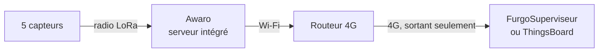
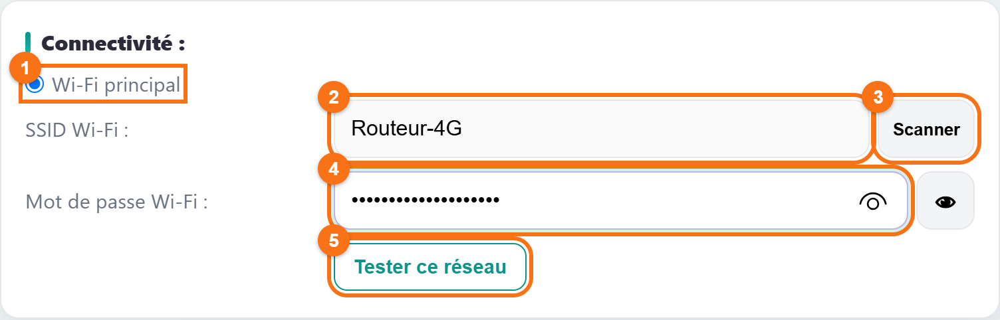
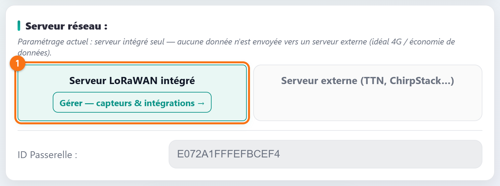
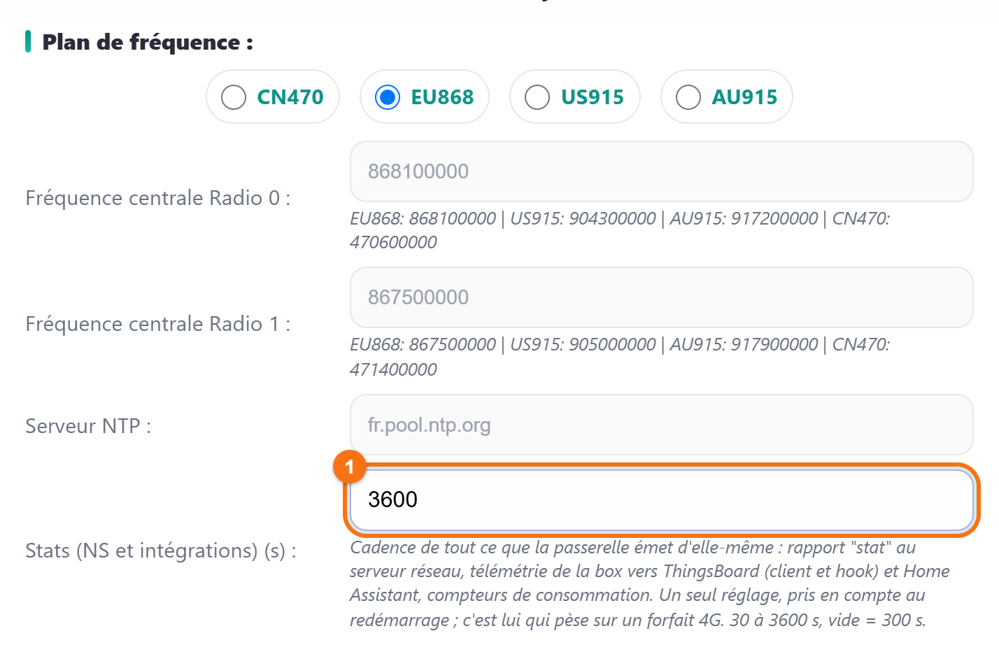

# Installer la box sur un site sans Internet, avec un routeur 4G

Un hangar, une ferme, une station de pompage : pas de box Internet, mais
quelques capteurs à surveiller. La solution tient en deux appareils : un
**routeur 4G** qui fournit le Wi-Fi, et la box Awaro avec son **serveur
intégré**, qui accueille les capteurs, décode leurs mesures et les envoie à
votre tableau de bord en ligne.

Le cas de ce tuto : **5 capteurs** sur un site en 4G, leurs mesures envoyées à
**FurgoSuperviseur** ou à votre propre **ThingsBoard**, et une consommation de
données réduite au minimum. Prêt ? C'est parti !

*Captures réalisées avec la page de configuration du firmware 3.6.6. Les
pastilles orange numérotées renvoient aux tableaux sous chaque capture.*

## Petit rappel : le chemin des mesures

Deux choses à retenir sur la 4G :

| Particularité | Conséquence pour vous |
|---|---|
| **Chaque Mo compte** sur un forfait data. | Seules les mesures doivent sortir, et le moins souvent possible pour le reste. C'est l'objet de l'étape 4. |
| **Rien ne peut entrer.** L'opérateur place votre routeur derrière une adresse partagée : on ne peut pas ouvrir la page de la box depuis Internet. | Tout se règle sur place. À distance, on passe par la liaison que la box ouvre elle-même vers la supervision (étape 7). |

## Ce qu'il vous faut

- un **routeur 4G** avec Wi-Fi (ou une clé 4G branchée sur un routeur Wi-Fi),
  et une carte SIM data ;
- une box **Awaro** et ses capteurs, avec les étiquettes de leurs clés ;
- un compte **FurgoSuperviseur** (son jeton d'accès est fourni avec
  l'abonnement) ou un serveur **ThingsBoard** ;
- un téléphone ou un ordinateur pour la mise en service, sur place.

## Étape 1 : préparer le routeur 4G

1. Insérez la SIM et vérifiez que le routeur accède à Internet.
2. Activez son Wi-Fi en **2,4 GHz**, protégé par un mot de passe (WPA2). La
   box ne voit pas les réseaux 5 GHz.
3. Notez le **nom du réseau** (SSID) et son **mot de passe**.
4. Placez le routeur là où la 4G passe le mieux (près d'une fenêtre, en
   hauteur), et la box là où elle entend le mieux les capteurs. Seul le Wi-Fi
   doit relier les deux.

## Étape 2 : connecter la box au Wi-Fi du routeur

Ouvrez la page de configuration de la box, carte **Connectivité**.

*La box réglée sur le Wi-Fi du routeur 4G ; le nom et le mot de passe sont
des exemples.*

| Repère | Élément | À quoi il sert | Dans ce tuto |
|---|---|---|---|
| 1 | **Wi-Fi principal** / **Wi-Fi secondaire** | Le réseau habituel de la box, et un réseau de secours facultatif (visible en Paramétrage avancé). | **Wi-Fi principal** : c'est le routeur 4G. |
| 2 | **SSID Wi-Fi** | Le nom du réseau. | Celui du routeur, noté à l'étape 1. |
| 3 | **Scanner** | Liste les réseaux que la box capte, pour choisir sans faute de frappe. | Conseillé. |
| 4 | **Mot de passe Wi-Fi** | Le mot de passe du réseau. Il n'est jamais réaffiché : des points indiquent qu'il existe. | Celui du routeur. |
| — | Œil | Affiche ce que vous tapez. | Facultatif. |
| 5 | **Tester ce réseau** | Vérifie que la box se connecte et obtient une adresse, sans rien enregistrer. | **À faire** avant d'enregistrer. |
| — | **Wi-Fi entreprise (802.1X)** | Réseaux d'entreprise avec identifiant personnel. | Inutile ici. |

Enregistrez avec **Appliquer et redémarrer**, en bas de la page.

## Étape 3 : allumer le serveur intégré seul

Carte **Serveur réseau** : allumez **Serveur LoRaWAN intégré** et laissez
**Serveur externe** éteint, comme à l'étape 1 du tuto
[Recevoir les mesures d'un capteur Dragino sur votre broker MQTT](tuto-dragino-vers-broker-mqtt.md#étape-1--activer-le-serveur-intégré).

*Serveur intégré seul : rien ne part vers un serveur LoRaWAN externe.*

Sans serveur externe, la box n'envoie plus le signal de vie qu'un serveur
LoRaWAN externe exige toutes les 25 secondes, même quand aucun capteur ne
parle.

## Étape 4 : espacer les statistiques à 3600 s

Passez en **Paramétrage avancé** (bouton en haut de la page), puis ouvrez
**Paramètres système**.

*Le réglage qui pèse sur le forfait : une heure entre deux rapports.*

| Repère | Champ | Ce qu'il règle | Dans ce tuto |
|---|---|---|---|
| — | **Plan de fréquence** | La bande radio de la box. | `EU868` en Europe : n'y touchez pas. |
| — | **Fréquence centrale Radio 0 / Radio 1** | Les fréquences d'écoute, déduites du plan. | N'y touchez pas. |
| — | **Serveur NTP** | Le serveur qui donne l'heure à la box. | Laissez la valeur proposée. |
| 1 | **Stats (NS et intégrations) (s)** | La cadence de tout ce que la box émet d'elle-même : état de la box vers ThingsBoard et Home Assistant, compteurs de consommation, rapport au serveur externe. De 30 à 3600 s ; vide = 300 s. | **`3600`** : un rapport par heure. |

Ce réglage est pris en compte au redémarrage : **Appliquer et redémarrer**.
Il ne ralentit pas les mesures : chaque trame d'un capteur part dès sa
réception.

## Étape 5 : déclarer les capteurs, avec un historique

Déclarez chaque capteur sur la page `/lns`, carte **Ajouter un capteur**,
comme à l'étape 2 du
[tuto Dragino](tuto-dragino-vers-broker-mqtt.md#étape-2--déclarer-le-capteur)
(DevEUI, AppKey, nom, décodeur).

Puis, dans la carte **Capteurs déclarés**, passez la colonne **Historique**
de chaque capteur à `100`.

> [!IMPORTANT]
> **Le bon réglage : l'Historique à `100`.** La 4G décroche de temps en temps.
> Avec un historique, la box garde les trames reçues pendant la coupure et les
> renvoie au retour du réseau, marquées `"replay":true` ; ThingsBoard les
> replace au bon moment grâce à leur horodatage. Sans historique, elles sont
> perdues pour la supervision. 100 lignes occupent 9 Ko de mémoire.

## Étape 6 : envoyer les mesures vers la supervision

Page `/lns`, carte **Intégrations**, ligne du bas. Choisissez le **Type**
selon votre service :

| Champ | FurgoSuperviseur | Votre ThingsBoard |
|---|---|---|
| **Type** | `FurgoSuperviseur` | `ThingsBoard` |
| **Nom** | Libre, par exemple `supervision`. | Libre. |
| **Groupes** | Vide : tous les capteurs. | Vide : tous les capteurs. |
| **Serveur** | Prérempli. | `hôte:1883`, ou `mqtts://hôte:8883` si le serveur est en TLS (cas de ThingsBoard Cloud). |
| **Jeton d'accès** | Le jeton fourni avec votre abonnement. | L'**Access token** d'un device de type *gateway* créé dans ThingsBoard pour la box. |

Cliquez sur **Ajouter**, attendez une vingtaine de secondes, puis sur **test** :
la colonne **État** doit passer au vert. Chaque capteur apparaît ensuite
automatiquement dans ThingsBoard, sous son DevEUI.

## Étape 7 : commander un capteur à distance

La page `/lns` ne s'ouvre que sur place, derrière le routeur. À distance, on
passe par la liaison que la box entretient avec la supervision : dans
ThingsBoard, la commande s'envoie par la **RPC `downlink`** du capteur, avec
trois paramètres :

| Paramètre | Contenu |
|---|---|
| `fport` | Le port de la commande (voir la notice du capteur). |
| `data` | La commande en hexadécimal. |
| `confirmed` | `true` pour demander un accusé de réception. |

Un capteur sur pile n'écoute que juste après ses propres émissions : la
commande part à sa trame suivante.

## Combien de données sur le forfait ?

Estimation pour ce cas, à partir des volumes mesurés sur notre banc d'essai :

| Poste | Par mois |
|---|---|
| Liaison avec la supervision : connexion entretenue, état de la box toutes les heures, lecture de sa configuration | ~10 Mo |
| 5 capteurs, une mesure toutes les 20 minutes, envoyées à ThingsBoard (~560 octets chacune) | ~6 Mo |
| Heure et vérification des mises à jour | ~0,3 Mo |
| **Total** | **~16 Mo** |

Deux postes viennent s'y ajouter ponctuellement : chaque **mise à jour du
firmware** télécharge l'image complète, et la **prise en main à distance** par
le support consomme le temps de la session.

> [!TIP]
> **Vérifiez sur votre box.** En **Paramétrage avancé**, rubrique **Système**,
> la ligne **Données consommées** affiche ce que la box a échangé depuis son
> démarrage, une estimation par mois à ce rythme, et le détail par usage
> (LoRaWAN, Intégrations, Supervision, Accès distant, Mises à jour). Relevez-la
> après quelques jours pour choisir votre forfait.

> [!NOTE]
> **Et pour 50 capteurs ?** Le serveur intégré convient aux petits parcs comme
> celui-ci. Pour un grand parc sur un site déjà relié à Internet, la box peut
> aussi servir de passerelle à TTN : voyez le tuto
> [Récupérer les mesures de vos capteurs sur TTN](tuto-recuperer-mes-donnees-sur-ttn.md)
> et la description
> [Serveur LoRaWAN intégré ou serveur externe](description-serveur-integre-ou-externe.md).

## Variante : la 4G en secours d'une box Internet

Le site a une box Internet, mais elle tombe parfois ? Mettez la box Internet
en **Wi-Fi principal** et le routeur 4G en **Wi-Fi secondaire** (carte
Connectivité, en Paramétrage avancé). La box ne bascule sur la 4G que si le
réseau principal n'a plus d'adresse ou plus d'Internet pendant 3 minutes.
Elle revérifie ensuite le principal toutes les 15 minutes (jusqu'à une heure
après des essais ratés), et y revient dès qu'Internet y répond.

## En résumé

- Un **routeur 4G** en Wi-Fi 2,4 GHz, et la box en **Wi-Fi principal** dessus.
- **Serveur intégré seul** : pas de signal de vie vers un serveur externe.
- **Stats à 3600 s** : un rapport par heure, au lieu d'un toutes les 5 minutes.
- **Historique à 100** sur chaque capteur, pour rattraper les coupures 4G.
- Une intégration **FurgoSuperviseur** ou **ThingsBoard** pour les mesures et
  les commandes à distance.
- Environ **16 Mo par mois** pour 5 capteurs : vérifiez avec la ligne
  **Données consommées**.

Et vous, combien consomme votre box en 4G ? Partagez votre relevé, ou
signalez un souci, dans les
[issues du dépôt](https://github.com/Di-Ny/awaro/issues).
